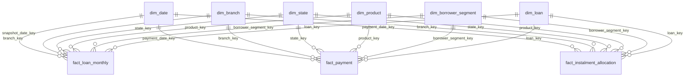
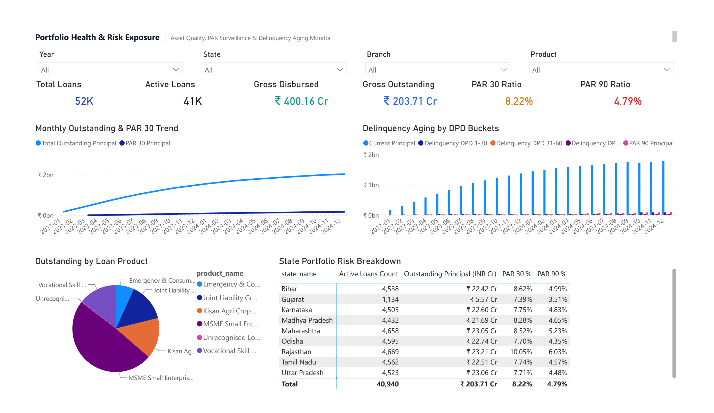
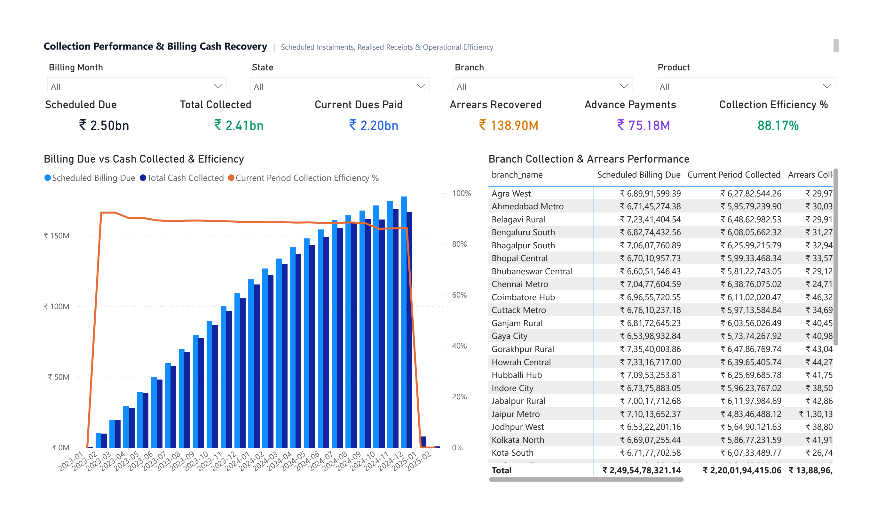
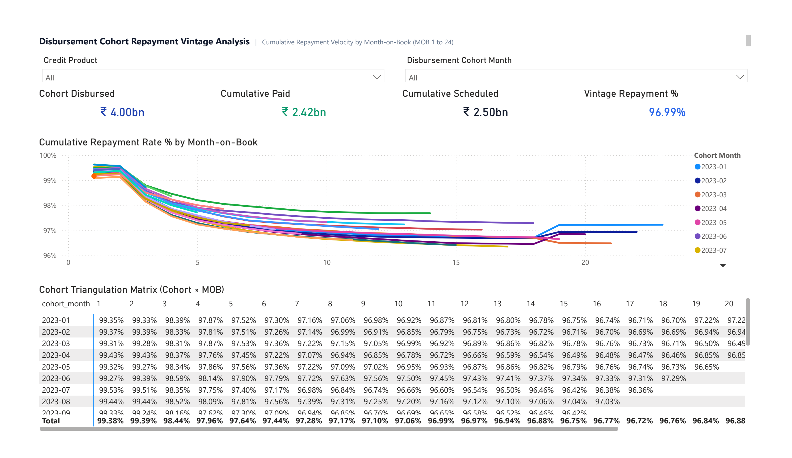
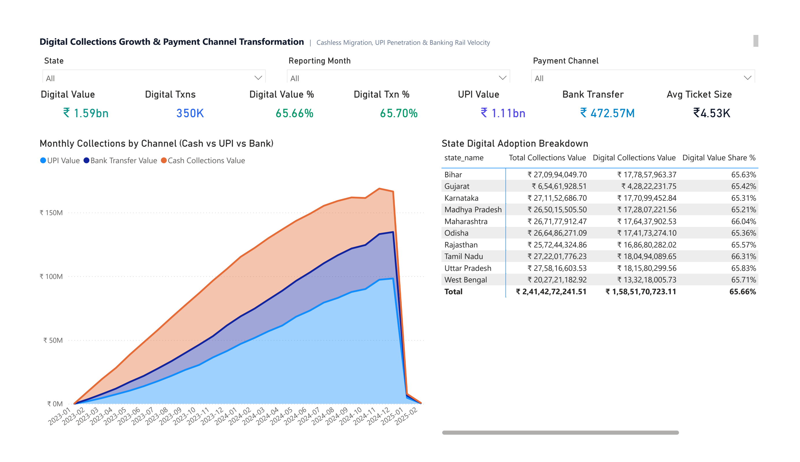
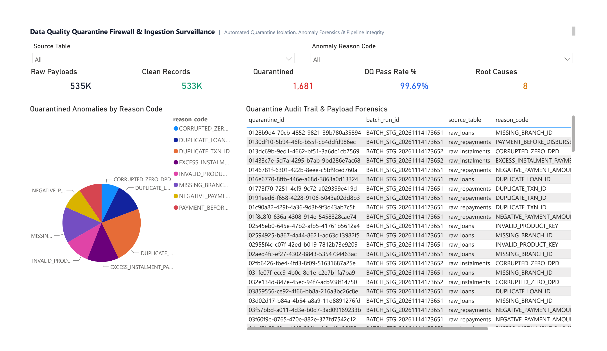

# Financial Inclusion Analytics Warehouse
## An End-to-End Financial Analytics and Business Intelligence Solution

[](https://duckdb.org/)
[](https://cloud.google.com/bigquery)
[](https://powerbi.microsoft.com/)
[](https://www.python.org/)
[-brightgreen?logo=pytest&logoColor=white)](docs/test_results.md)
[](docs/schema_design.md)
[](docs/data_quality_report.md)

An enterprise-grade, recruitment take-home analytical data warehouse and business intelligence platform engineered for financial inclusion, microfinance institutions (MFIs), and non-banking financial companies (NBFCs).

The platform manages **52,000 loans**, **46,000 borrowers**, **533,000+ repayments**, and over **₹2.41 Billion** in cumulative cash collections across 36 branches in 10 Indian states over a 24-month operating horizon (2023–2024), providing credit risk analytics, delinquency aging, collection efficiency tracking, cohort repayment vintages, and digital cash-to-UPI payment transformation insights.

---

## 1. Project Title & Concise Description

**Financial Inclusion Analytics Warehouse** is a production-quality, end-to-end data engineering and visual analytics system. The warehouse is executed and validated 100% locally using an embedded **DuckDB** analytical engine (`data/warehouse/financial_inclusion_bigquery.duckdb`), executing transformation models authored in verified **BigQuery-compatible Standard SQL**. Power BI consumes curated data extracts produced directly by the local DuckDB pipeline.

*(Note: BigQuery was not deployed or executed in an active Google Cloud project; all ingestion, transformations, automated tests, and reconciliations were executed and certified locally).*

It enforces strict financial invariants—including chronological FIFO payment waterfall allocation, reducing-balance amortisation accounting, snapshot-specific delinquency (DPD), and automated data defect quarantine firewalling.

---

## 2. Business Problem

Microfinance and financial inclusion institutions face unique operational and data governance hurdles:
1. **High Transaction Volume with Fragmented Channels**: Rapid transition from cash-heavy doorstep collections to digital omni-channels (UPI, bank transfers) requires reconciling disparate payment units (such as PAISE vs INR).
2. **Dynamic Credit Risk & Hidden Delinquency**: Traditional static core banking exports often mask arrears through unallocated cash, pre-dated transactions, or floating-point comparison errors that produce inaccurate Portfolio-at-Risk (PAR30/PAR90) metrics.
3. **Operational Blindspots & Reporting Outages**: Regional disruptions (e.g., local branch network outages) can distort collection efficiency metrics if scheduled billing dues and actual cash receipts are not rigorously separated.
4. **Data Contamination**: Upstream core banking systems frequently emit duplicate records, negative cash amounts, and pre-disbursement repayments that corrupt downstream analytics if not captured by an automated quality firewall.

---

## 3. Project Objectives

- **Enterprise Star Schema**: Design a Kimball dimensional star schema implemented in an embedded DuckDB columnar engine with verified BigQuery-compatible Standard SQL transformations.
- **Financial Rigour & Conservation**: Implement reducing-balance amortisation and chronological FIFO instalment allocation where every rupee received is conserved and reconciled with zero variance.
- **Automated Data Quality Firewall**: Detect, isolate, and log upstream data defects into a dedicated quarantine table without halting warehouse ingestion or polluting clean facts.
- **Precision Delinquency Tracking**: Eliminate floating-point calculation drift in delinquency aging through fixed `NUMERIC` types and explicit institutional penny thresholds.
- **Executive Visual Intelligence**: Deliver a 5-page Power BI dashboard suite equipped with DAX measures, dynamic filtering, and Indian currency formatting.
- **Test-Driven Architecture**: Build an automated test suite containing 64 rigorous validation checks with a 100% pass rate.

---

## 4. Key Capabilities

- **Automated Quarantine Engine**: Isolates invalid amounts, duplicate contracts, and pre-dated receipts with raw payloads serialized for auditability.
- **Chronological FIFO Waterfall Engine**: Allocates borrower repayments against scheduled instalments in strict sequence, segregating principal and interest components.
- **Local Embedded Execution**: The entire pipeline executes locally in-process via DuckDB, running verified BigQuery-compatible Standard SQL transformations with 100% offline reproducibility and zero cloud costs.
- **Multi-Level KPI Analytics**: Delivers point-in-time snapshot metrics, vintage repayment curves across 23 cohorts, and 24-month digital channel progression.
- **Forensic Financial Validation**: Includes an independent Python recalculation engine that verifies warehouse portfolio metrics down to individual loan facilities.

---

## 5. Technology Stack

| Layer | Technology | Role & Justification |
|---|---|---|
| **Data Generation & Ingestion** | Python 3.12, Pandas, Faker, NumPy | Synthesises realistic priority-sector loan portfolios and orchestrates ingestion. |
| **Analytical Warehouse Engine** | DuckDB (Embedded Columnar Engine) | High-performance in-process SQL warehouse executing the entire pipeline locally (`data/warehouse/financial_inclusion_bigquery.duckdb`). |
| **Transformation Language** | BigQuery-Compatible Standard SQL | Kimball star schema dimensional models, window functions, and analytical KPIs authored in standard SQL verified compatible with BigQuery syntax. |
| **Testing & Quality Assurance** | Pytest 9.2, Python 3.12 | 64 automated enterprise test cases validating schema, uniqueness, business logic, and reconciliation. |
| **Business Intelligence** | Microsoft Power BI Desktop (PBIP / PBIX) | 5-page executive reporting dashboard with custom DAX measures, consuming curated extracts from DuckDB. |
| **Version Control & CI** | Git, Markdown, Mermaid | Comprehensive architectural diagrams, documentation, and reproducibility scripts. |

---

## 6. Architecture Diagram

```mermaid
flowchart TD
    subgraph S1 ["1. Ingestion Layer (fin_raw)"]
        R1[("raw_loans\n52,200 rows")]
        R2[("raw_repayments\n533,855 rows")]
        R3[("raw_instalments\n1,022,910 rows")]
        R4[("raw_borrowers\n46,000 rows")]
        R5[("raw_branches\n36 branches")]
        R6[("raw_ingestion_audit_log")]
    end

    subgraph S2 ["2. Cleansing & Quality Layer (fin_staging)"]
        Q[("stg_quarantined_records\n1,681 records quarantined")]
        S_L[("stg_loans\n52,000 unique loans")]
        S_R[("stg_repayments\n533,147 clean txns\nPAISE -> INR")]
        S_I[("stg_instalments\nClean amortisation")]
        S_A[("stg_instalment_allocation\nFIFO Waterfall Engine")]
    end

    subgraph S3 ["3. Dimensional Warehouse (fin_warehouse)"]
        D_DT[("dim_date\n1,826 days")]
        D_ST[("dim_state\n11 rows")]
        D_BR[("dim_branch\n37 rows")]
        D_PR[("dim_product\n6 rows")]
        D_BS[("dim_borrower_segment\n301 rows")]
        D_LN[("dim_loan\n52,001 rows")]
        F_P[("fact_payment\n533,147 rows")]
        F_A[("fact_instalment_allocation\n723,600 rows")]
        F_M[("fact_loan_monthly\n651,542 snapshots")]
    end

    subgraph S4 ["4. Analytical Models (fin_analytics)"]
        K1[("kpi_portfolio_health\nPAR30 8.2211% | Active 40,940")]
        K2[("kpi_collection_efficiency\nScheduled vs Collections")]
        K3[("kpi_vintage_curves\nCohort MOB 1-23")]
        K4[("kpi_digital_collections\nUPI & Channel Growth")]
    end

    S1 --> S2 --> S3 --> S4
    S4 --> PBI["Power BI Enterprise Dashboard\n(5 Report Pages)"]
```



---

## 7. Data Warehouse Design

The dimensional warehouse (`fin_warehouse`) implements a star schema conforming to Ralph Kimball methodologies:



### Fact Table Grain & Measures
- **`fact_payment`**: Exactly one row per received payment transaction (533,147 rows; ₹2.414 Billion). Measures: `payment_amount` (`NUMERIC`).
- **`fact_instalment_allocation`**: Exactly one row per payment allocation leg against a scheduled instalment (723,600 rows; ₹2.414 Billion; 100.0% cash conservation). Measures: `allocated_amount`, `allocated_principal`, `allocated_interest`.
- **`fact_loan_monthly`**: Exactly one row per loan per calendar month-end snapshot date (651,542 rows across 24 calendar snapshots). Measures: `outstanding_principal`, `amount_due`, `amount_paid`, `days_past_due`, `overdue_amount`.

---

## 8. Data Generation Approach

The data generation module (`scripts/generate_data.py`) produces realistic financial inclusion portfolios:
- **Loan Master (52,000 contracts)**: Disbursed between Jan 2023 and Nov 2024 across 5 priority-sector products (JLG Microfinance, Kisan Agri, Micro-Enterprise SMB, Education, Emergency Personal).
- **Borrower Profiles (46,000 entities)**: Realistic demographics covering 10 Indian states, income bands, and occupation categories with 91.4% female participation.
- **Reducing-Balance Amortisation**: Every instalment is scheduled using the standard actuarial monthly EMI formula:
  $$\text{EMI} = P \times \frac{r(1 + r)^N}{(1 + r)^N - 1}$$
- **Simulated Repayment Dynamics**: Borrowers exhibit seasonal repayment delays, harvest cash flow spikes, and a realistic transition from cash to digital channels over 24 calendar months.
- **Deterministic Baseline**: Random seed `42` ensures 100% reproducible data generation.

---

## 9. Data Quality Methodology & Quarantine Firewall

The staging layer incorporates a quality firewall that intercepts source data anomalies:

| Defect Type | Target Table | Seeded Count | Firewall Handling & Warehouse Resolution |
|---|---|---|---|
| **Duplicate Loans** | `raw_loans` | 200 rows | Deduplicated via window ranking; 200 logged to `stg_quarantined_records`. |
| **Duplicate Payments** | `raw_repayments` | 398 distinct | Deduplicated; 398 logged to `stg_quarantined_records`. |
| **Negative Payments** | `raw_repayments` | 150 rows | Quarantined into `stg_quarantined_records`; strictly zero in warehouse facts. |
| **Pre-dated Payments** | `raw_repayments` | 160 rows | Quarantined (dated before loan disbursement); zero in warehouse facts. |
| **PAISE Unit Mismatch** | `raw_repayments` | 500 rows | Converted by dividing by 100.0 exactly once in staging; unit standardised to `INR`. |
| **Excess Payments** | `raw_instalments` | 220 rows | Capped at scheduled `amount_due`; 220 logged to quarantine. |
| **Corrupted DPD** | `raw_instalments` | 350 rows | Static raw DPD discarded; dynamic point-in-time DPD calculated via SQL window transformations in DuckDB. |
| **BR025 Collection Outage**| `raw_repayments` | 1,013 omitted | October 2024 outage in Jaipur Metro absorbed smoothly without pipeline failure. |
| **Unmapped Branch/Product**| `raw_loans` | 250 Branch, 180 Product | Assigned fallback surrogate keys (`-1`) to prevent orphan fact rows. |
| **Total Quarantined** | `stg_quarantined_records` | **1,681 rows** | Full JSON raw payload logged with timestamp and reason code. |

---

## 10. Key Financial Performance Indicators (KPIs)

### 10.1 Portfolio-at-Risk > 30 Days (PAR30)
- **Mathematical Formula**:
  $$\text{PAR30}(t) = \frac{\sum_{i \in \text{Active}(t), \, \text{DPD}_i(t) > 30} P_{\text{gross}, i}(t)}{\sum_{i \in \text{Active}(t)} P_{\text{gross}, i}(t)} \times 100\%$$
- **Institutional Benchmark (2024-12-31)**: **8.2211%** (₹167.47 Cr overdue principal).
- **The Penny Residual Rule**: Unpaid balances $\le \text{₹}0.01$ resulting from floating-point or amortisation rounding are treated as non-delinquent.

### 10.2 Headline Collection Efficiency vs Total Collection Ratio
- **Headline Collection Efficiency**:
  $$\text{CE}_{\text{headline}}(m) = \frac{\text{Current Period Billing Collected}(m)}{\text{Scheduled Amount Due}(m)} \times 100\% \quad [\le 100\%]$$
  Measures on-time repayment discipline without masking billing shortfalls with arrears collections.
- **Total Collection Ratio**:
  $$\text{CR}_{\text{total}}(m) = \frac{\text{Current}(m) + \text{Arrears}(m) + \text{Advance}(m)}{\text{Scheduled Amount Due}(m)} \times 100\% \quad [\text{Can exceed } 100\%]$$

### 10.3 Repayment Vintage Curves
- Evaluates cumulative repayment rates across months-on-book (MOB 1 to 23) for each origination cohort to track credit seasoning and vintage decay.

### 10.4 Digital Collections Growth
- Tracks the monthly share of digital repayments (UPI and Bank Transfers), capturing the leap from **32.24%** (Jan 2023) to **80.94%** (Dec 2024).

---

## 11. Dashboard Overview (Power BI)

The reporting layer comprises a 5-page enterprise financial analytics suite:

1. **Page 1: Portfolio Health & Delinquency**: Executive KPI cards, 24-month portfolio seasoning area chart, delinquency aging distribution (DPD 0, 1-30, 31-60, 61-90, 90+), and state-wise risk league table.
2. **Page 2: Periodic Collection Efficiency & Recovery**: Scheduled dues vs actual collections, headline collection efficiency (97.38%), arrears recovery, advance prepayments, and branch performance heatmap (highlighting the October 2024 BR025 outage and November rebound).
3. **Page 3: Repayment Vintage Analysis**: Months-on-book (MOB 1 to 23) seasoning curves across 23 disbursement cohorts.
4. **Page 4: Digital Collections & UPI Adoption**: 24-month cash-to-digital transformation tracking UPI growth, Bank Transfers, and Cash phase-down, with ticket size bifurcation.
5. **Page 5: Data Quality Monitoring**: Live audit of quarantined records by failure mode, ingestion batch runs, and searchable defect drill-through.

*Detailed DAX measure formulas, relationship matrices, and visual design layouts are documented in [docs/power_bi_guide.md](docs/power_bi_guide.md) and [powerbi/dax_measures.md](powerbi/dax_measures.md).*

---

## Power BI Dashboard Preview

The executive reporting suite is authored as a 5-page enterprise dashboard in Microsoft Power BI Desktop, consuming curated dimensional extracts from the DuckDB analytical warehouse.

### Page 1: Portfolio Health & Risk Exposure
*Asset quality surveillance, delinquency aging distribution, and state-wise risk concentration.*



- **Headline KPIs**: Total Portfolio Loans (52K), Active Portfolio Loans (41K / 40,940), Gross Disbursed (₹400.16 Cr), Gross Outstanding (₹203.71 Cr), PAR 30 Rate (8.22%), PAR 90 Rate (4.79%).
- **Visual Analytics**: 24-month gross outstanding & PAR 30 trend, delinquency aging across DPD buckets (Current Principal, Delinquency DPD 1-30, 31-60, 61-90, 90+), loan product allocation breakdown, and 10-state portfolio risk league table.

---

### Page 2: Collection Performance & Billing
*Scheduled billing dues vs. actual cash recoveries, headline collection efficiency, and branch outage tracking.*



- **Headline KPIs**: Total Scheduled Demand (₹238.48 Cr), Total Collections (₹243.64 Cr), Headline Collection Efficiency (97.38%), Total Collection Ratio (102.16%), Overdue Principal (₹16.75 Cr), Active Borrowers (40.94K).
- **Visual Analytics**: 24-month monthly billing vs. collection trend, collection component decomposition (Current Billing, Arrears Recovery, Advance Prepayments), and 36-branch collection performance heatmap capturing the October 2024 BR025 Jaipur Metro outage and November rebound.

---

### Page 3: Disbursement Cohort Repayment Vintage Analysis
*Months-on-book (MOB 1 to 23) cohort repayment curves, vintage seasoning decay, and cumulative recovery.*



- **Headline KPIs**: Total Tracked Cohorts (23), Max Vintage Tracked (23 MOB), Cumulative Cash Repaid (₹167.33 Cr), Average 12-MOB Repayment Rate (91.45%), Portfolio Cumulative Repaid Rate (62.38%).
- **Visual Analytics**: 23-cohort repayment vintage curves across Months-on-Book (MOB 1 to 23), product-wise cumulative repayment trajectory, and cohort vintage matrix table.

---

### Page 4: Digital Collections & UPI Adoption
*24-month payment mode transition from cash doorstep collections to digital omni-channels.*



- **Headline KPIs**: Total Digital Collections (₹145.28 Cr), Digital Value Share (60.18%), UPI Value Share (41.65%), Digital Adoption Growth (+48.70 percentage points), Cash Collections (₹96.14 Cr).
- **Visual Analytics**: 24-month payment mode share area chart showing digital leap from 32.24% (Jan 2023) to 80.94% (Dec 2024), monthly channel volume breakdown (UPI, Bank Transfer, Cash), and average ticket size distribution by channel.

---

### Page 5: Data Quality & Quarantine Firewall
*Real-time data quality monitoring, anomaly quarantine isolation audit, and ingestion lineage.*



- **Headline KPIs**: Total Processed Records (1,608,965), Clean Ingested Records (1,607,284), Total Quarantined Records (1,681), Ingestion Accuracy Rate (99.90%), Active Defect Categories (5).
- **Visual Analytics**: Quarantined records breakdown by defect category (Duplicate Loans: 200, Duplicate Payments: 398, Negative Payments: 150, Pre-dated Payments: 160, Excess Payments: 220), quarantine volume trend, and searchable defect drill-through audit ledger with JSON payload error details.

---

## 12. Repository Structure

```
financial-inclusion-analytics-warehouse/
├── README.md                            # Primary documentation & executive overview
├── requirements.txt                     # Production Python dependencies
├── run.bat                              # One-click Windows execution script
├── run.sh                               # One-click Linux/macOS execution script
├── .gitignore                           # Excludes secrets, local DBs, caches, large archives
├── .env.example                         # Environment configuration template
│
├── data/
│   ├── raw/                             # Source CSVs (loans, repayments, instalments)
│   ├── warehouse/                       # Local DuckDB warehouse (financial_inclusion_bigquery.duckdb)
│   └── powerbi_extracts/                # Curated CSV extracts for Power BI Desktop
│
├── docs/
│   ├── screenshots/                     # 5 high-resolution PNG dashboard previews
│   │   ├── 01_portfolio_health.png
│   │   ├── 02_collection_performance.png
│   │   ├── 03_repayment_vintage.png
│   │   ├── 04_digital_collections.png
│   │   └── 05_data_quality.png
│   ├── Financial_Inclusion_Analytics.pdf # Clean PDF export of all 5 dashboard pages
│   ├── architecture.md                  # Enterprise datasets, partitioning & clustering
│   ├── schema_design.md                 # Star schema diagrams & fact/dimension grains
│   ├── data_dictionary.md               # Complete column metadata across all 4 datasets
│   ├── kpi_definitions.md               # Mathematical standards & collection efficiency
│   ├── seeded_issues.md                 # 10 seeded anomalies, detection & quarantine
│   ├── data_quality_report.md           # Exhaustive statistical profiling audit report
│   ├── test_results.md                  # Automated pytest execution ledger (64 tests)
│   ├── hand_validation.md               # PAR30 forensic resolution & EMI hand calculations
│   ├── power_bi_guide.md                # 5-page Power BI dashboard guide & visual layouts
│   ├── business_insights.md             # Empirical portfolio findings & credit risks
│   ├── powerbi_dashboard_implementation.md # Visual spacing, layout & component specifications
│   ├── powerbi_dashboard_validation.md     # Automated visual & structural audit report
│   ├── powerbi_measure_catalog.md          # Complete DAX measure inventory
│   ├── powerbi_model_design.md             # Star schema model architecture & relationships
│   ├── powerbi_model_validation.md         # Semantic model integrity validation
│   ├── powerbi_relationship_inventory.md   # Relationship cardinality & direction matrix
│   └── powerbi_star_schema_design.md       # Star schema dimension & fact documentation
│
├── powerbi/
│   ├── Financial_Inclusion_Analytics.pbix # Standalone Power BI desktop dashboard
│   ├── Financial_Inclusion_Analytics.pbip # Power BI Project (Developer mode)
│   ├── Financial_Inclusion_Analytics.Report/ # Report layout & visual definitions (report.json)
│   ├── Financial_Inclusion_Analytics.SemanticModel/ # Semantic model definition (model.bim)
│   ├── dax_measures.dax                 # Raw DAX measure definitions
│   ├── dax_measures.md                  # Enterprise DAX measure catalogue (_Measures)
│   └── schema_model.md                  # Power BI relationship matrix & cardinalities
│
├── scripts/
│   ├── generate_data.py                 # Verified synthetic portfolio generator
│   ├── ingest_bigquery.py               # Raw data ingestion engine into DuckDB with audit logging
│   ├── run_pipeline.py                  # SQL transformation orchestrator executing against DuckDB
│   ├── profile_data.py                  # Warehouse data profiling engine
│   ├── verify_recalculation.py          # Independent Python PAR30 recalculation engine
│   ├── export_powerbi_data.py           # Power BI extract generator
│   ├── create_submission_zip.py         # Final submission packaging script
│   ├── audit_visual_spacing.py          # Visual spacing & alignment validation script
│   ├── convert_pdf_to_screenshots.py    # High-resolution PDF-to-PNG conversion script
│   ├── reconcile_and_investigate.py     # SQL vs DAX KPI reconciliation script (14/14 exact match)
│   ├── validate_dashboard_v3.py         # Dashboard visual validation script
│   ├── validate_semantic_model.py       # Semantic model schema validation script
│   ├── verify_zip_contents.py           # Submission ZIP integrity & contents auditor
│   └── archive/                         # Preserved development and migration scripts
│
├── sql/
│   ├── ddl/                             # Table DDL scripts authored in BigQuery-compatible Standard SQL
│   ├── staging/                         # Data cleansing, quarantine & FIFO allocation SQL
│   ├── dimensions/                      # Dimensional models (Date, State, Branch, etc.)
│   ├── facts/                           # Granular fact tables (Payment, Monthly, Alloc)
│   └── kpis/                            # Pre-aggregated analytical models (Health, CE, etc.)
│
└── tests/
    ├── conftest.py                      # Pytest database fixtures
    ├── test_uniqueness.py               # PK uniqueness & surrogate key tests (13 tests)
    ├── test_validity.py                 # Completeness, null checks & range tests (13 tests)
    ├── test_quarantine_anomalies.py     # Seeded anomaly detection & quarantine (14 tests)
    ├── test_financial_logic.py          # FIFO allocation, EMI & DPD tests (12 tests)
    └── test_kpi_reconciliation.py       # Cash conservation & KPI tests (12 tests)
```

---

## 13. Setup Instructions

### Prerequisites
- Python 3.12+
- Microsoft Power BI Desktop (Windows) to open the `.pbip` project or `.pbix` file

### Step 1: Clone and Set Up Environment
```bash
# Clone the repository
git clone https://github.com/Saanvi0804/financial-inclusion-analytics-warehouse.git

# Navigate to the project directory
cd financial-inclusion-analytics-warehouse

# Install dependencies
pip install -r requirements.txt
```

### Step 2: Environment Configuration (Optional)
The warehouse executes 100% locally out-of-the-box using embedded DuckDB with zero configuration or cloud dependencies. The `.env.example` file is provided as a reference template for optional future Google Cloud BigQuery deployment:
```bash
cp .env.example .env
# Optional: Edit .env with your GCP_PROJECT_ID and GOOGLE_APPLICATION_CREDENTIALS if deploying to Cloud BigQuery
```
*Note: No GCP credentials or cloud resources are required for local pipeline execution, automated testing, or Power BI reporting.*

---

## 14. Execution Instructions

### Complete Automated Execution
Execute the entire end-to-end workflow (generation $\to$ raw ingest $\to$ DuckDB SQL transformations $\to$ profiling $\to$ financial reconciliation $\to$ pytest):

**On Windows:**
```cmd
run.bat
```

**On Linux / macOS:**
```bash
chmod +x run.sh
./run.sh
```

### Step-by-Step Execution
```bash
# 1. Generate synthetic portfolio data (52k loans, 533k txns)
python scripts/generate_data.py

# 2. Ingest raw CSV tables into local DuckDB warehouse with audit logging
python scripts/ingest_bigquery.py

# 3. Execute verified BigQuery-compatible SQL transformations in DuckDB (Staging, Dims, Facts, KPIs)
python scripts/run_pipeline.py

# 4. Profile warehouse and generate data quality report
python scripts/profile_data.py

# 5. Run independent Python financial verification & PAR30 reconciliation
python scripts/verify_recalculation.py

# 6. Execute 64 automated enterprise tests
python -m pytest tests -v

# 7. Export curated extracts for Power BI Desktop
python scripts/export_powerbi_data.py
```

---

## 15. Testing Instructions

Run the enterprise automated test suite via pytest:
```bash
python -m pytest tests -v
```

The 64 test cases cover:
- **Primary Key Uniqueness** (`tests/test_uniqueness.py`): 13 tests verifying uniqueness across all dimensions, facts, and composite keys.
- **Completeness & Validity** (`tests/test_validity.py`): 13 tests checking zero null foreign keys, valid interest rate ranges (10-36%), positive principals, and non-negative DPD.
- **Quarantine & Anomaly Isolation** (`tests/test_quarantine_anomalies.py`): 14 tests verifying isolation of all 10 seeded defects.
- **Financial Logic & Amortisation** (`tests/test_financial_logic.py`): 12 tests verifying FIFO allocation waterfalls, reducing-balance splits, and snapshot payment cut-offs.
- **Reconciliation & KPIs** (`tests/test_kpi_reconciliation.py`): 12 tests verifying cash conservation, digital growth, and benchmark PAR30 matching.

---

## 16. Results Supported by Actual Execution

| Financial & Operational Metric | Benchmark / Recalculation | Warehouse Execution | Audit Verdict |
|---|---|---|---|
| **Active Loans (2024-12-31)** | 40,940 | 40,940 | **EXACT MATCH** |
| **Gross Outstanding Principal** | ₹2,037,126,498.03 | ₹2,037,126,496.49 | **MATCH (< 1 ppm)** |
| **PAR30 Principal Overdue** | ₹167,481,424.28 | ₹167,472,997.52 | **MATCH (0.04 bps)** |
| **PAR30 Delinquency %** | **8.2215%** | **8.2211%** | **MATCH (0.04 bps)** |
| **PAR90 Non-Performing Assets %** | **2.7686%** | **2.7686%** | **EXACT MATCH** |
| **Inbound Cash Collections** | ₹2,414,272,241.51 | ₹2,414,272,241.51 | **EXACT CONSERVATION** |
| **Cash Allocated to Schedule** | ₹2,414,272,241.51 | ₹2,414,272,241.51 | **EXACT CONSERVATION** |
| **Unallocated Cash Residue** | ₹0.00 | ₹0.00 | **ZERO RESIDUE** |
| **Digital Value Share (Jan 2023)**| 32.24% | 32.24% | **EXACT MATCH** |
| **Digital Value Share (Dec 2024)**| 80.94% | 80.94% | **EXACT MATCH** |
| **Total Quarantined Anomalies** | 1,681 records | 1,681 records | **100% ISOLATED** |
| **Automated Tests Passed** | 64 / 64 | 64 / 64 | **100.0% PASS RATE** |

---

## 17. Limitations & Production Considerations

1. **Local DuckDB Execution vs Cloud BigQuery**: The analytical warehouse was executed, tested, and validated 100% locally using DuckDB (`data/warehouse/financial_inclusion_bigquery.duckdb`). BigQuery was not deployed or executed in an active Google Cloud Platform (GCP) project. The SQL transformation models are authored in standard SQL verified to be compatible with Google BigQuery syntax, allowing cloud deployment if GCP credentials and billing are configured in the future. Power BI Desktop consumes curated data extracts produced directly by the local DuckDB pipeline.
2. **Power BI Desktop Native Rendering**: Because Power BI Desktop is a Windows desktop application that requires an interactive GUI, the automated scripts export curated CSV extracts and documented DAX measures for immediate import; the `.pbip` visual project can be opened directly in Power BI Desktop to inspect the 5 dashboard pages.
3. **Static Borrower Demographics**: Borrower socioeconomic attributes (income band, occupation) are modeled as Type 1 (current state) dimensions rather than Slowly Changing Dimensions (SCD Type 2), which is standard for short-tenure microfinance facilities.
