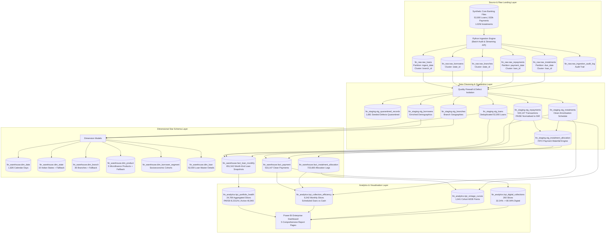

# Data Warehouse Architecture & Technical Design Specification

This document details the enterprise architecture, dataset design, partitioning and clustering strategies, data movement pipeline, and security governance for the **Financial Inclusion Analytics Warehouse**.

> **Implementation Note**: The analytical pipeline and warehouse models are implemented and executed locally using an embedded **DuckDB** analytical engine (`data/warehouse/financial_inclusion_bigquery.duckdb`), executing transformation scripts authored in **BigQuery-compatible Standard SQL**. The project was not deployed to Google Cloud Platform. Power BI consumes curated CSV extracts produced by the local DuckDB pipeline.

---

## 1. Enterprise Target Architecture Overview

The analytical warehouse implements an ELT (Extract-Load-Transform) medallion architecture natively on Google BigQuery Standard SQL, orchestrated via Python and validated through automated pytest suites.

---

## 2. BigQuery Datasets Design

Google BigQuery datasets are logically segregated into four tiers to enforce clean separation of concerns, data governance, and least-privilege security:

| Dataset Name | Role & Scope | Access Tier | Update Frequency | Data Retention |
|---|---|---|---|---|
| `fin_raw` | Raw landing of source CSV files, audit logs, and telemetry. Retains original amount units (`INR` and `PAISE`) and duplicates. | Data Engineering / Admin | Deterministic Full-Refresh (Batch) | Replaced on Full Refresh |
| `fin_staging` | Cleaned, deduplicated, and normalised tables. Houses the quarantine table `stg_quarantined_records` and FIFO allocation logic. | Data Engineering | Deterministic Full-Refresh (Batch) | Rebuilt on Pipeline Run |
| `fin_warehouse` | Dimensional star schema conforming to Kimball standards (6 dimensions, 3 granular facts). | Business Intelligence & Data Science | Deterministic Full-Refresh (Batch) | Rebuilt on Pipeline Run |
| `fin_analytics` | High-performance pre-aggregated analytical models powering Power BI executive dashboards, risk models, and reporting. | Business Analysts & Power BI | Deterministic Full-Refresh (Batch) | Rebuilt on Pipeline Run |

---

## 3. Partitioning and Clustering Strategies

To minimise BigQuery query scan costs (bytes processed) and ensure sub-second query performance in Power BI DirectQuery mode, partition pruning and multi-column clustering are configured on all major tables:

| Table | Partitioning Scheme | Clustering Keys | Architectural Justification |
|---|---|---|---|
| `fin_raw.raw_repayments` | `DATE(payment_date)` | `loan_id`, `payment_channel` | Prunes historical payments by billing month; clusters transaction lookups by loan ID. |
| `fin_raw.raw_instalments` | `DATE(due_date)` | `loan_id`, `instalment_number` | Accelerates due date filtering and loan instalment sequence lookups. |
| `fin_warehouse.fact_payment` | `DATE(payment_date)` | `loan_key`, `branch_key`, `payment_channel` | Optimises temporal slicing in Power BI; enables fast branch and channel filtering. |
| `fin_warehouse.fact_instalment_allocation` | `DATE(payment_date)` | `loan_key`, `instalment_id` | Aligns payment dates with instalment legs for cash conservation reconciliation. |
| `fin_warehouse.fact_loan_monthly` | `DATE(snapshot_date)` | `branch_key`, `product_key`, `state_key` | Prunes month-end reporting dates (24 calendar months); enables multi-dimensional filtering. |
| `fin_analytics.kpi_portfolio_health` | `DATE(snapshot_date)` | `state_name`, `product_name` | DirectQuery visual filters prune on snapshot date and drill down on geography. |
| `fin_analytics.kpi_collection_efficiency` | None (small table < 10 MB) | `year_month`, `state_name` | Clustered on time string and state name for fast matrix rendering. |

---

## 4. Execution Dialect & BigQuery Hybrid Engine

The pipeline is authored entirely in **Google BigQuery Standard SQL**:
- Uses BigQuery syntax: `CREATE OR REPLACE TABLE`, `SAFE_DIVIDE`, `FORMAT_DATE`, `CURRENT_TIMESTAMP()`, `NUMERIC` literals.
- **Hybrid Local-Cloud Execution**: When GCP credentials (`GOOGLE_APPLICATION_CREDENTIALS` or BigQuery client) are provided, the pipeline can execute directly against a cloud BigQuery project. In offline environments, `scripts/run_pipeline.py` executes against local DuckDB using a BigQuery dialect adaptation wrapper (`bq_to_duckdb`).
- **Deterministic Full-Refresh Workflow**: The pipeline operates as a deterministic full-refresh workflow, where each execution of `scripts/run_pipeline.py` cleanly replaces staging, dimensions, facts, and KPIs via idempotent `CREATE OR REPLACE TABLE` statements. It is not an incremental streaming or micro-batch ingestion pipeline.
- **Transaction Handling**: Individual SQL transformation models execute as standalone DDL statements without a single global database transaction wrapper (`BEGIN ... COMMIT`); idempotent full-refresh guarantees clean recovery upon re-running.
- **Data Types & Numeric Precision in DuckDB**: While BigQuery DDL defines `NUMERIC(12,2)`, the local DuckDB implementation evaluates division in PAISE normalisation into `DOUBLE` for `fact_payment.payment_amount`, `fact_instalment_allocation.allocated_amount`, and `fact_loan_monthly.outstanding_principal`. Values are protected by rounding functions and the internal penny tolerance rule; enforcing fixed-point `DECIMAL(18,2)` is identified as a future production improvement.

---

## 5. Security, Governance & Audit Lineage

1. **Audit Logging**: Every raw table ingestion generates an atomic execution record in `fin_raw.raw_ingestion_audit_log` detailing batch ID, source filename, row count, checksum, and status.
2. **Quarantine Traceability**: The quarantine firewall in `fin_staging.stg_quarantined_records` captures invalid records (negative amounts, pre-dated payments, corrupted DPD) with their complete raw payload serialized as JSON, preserving source lineage for compliance auditing without polluting clean warehouse facts.
3. **Immutability of Source Files**: Source CSVs remain untouched.
4. **Least Privilege**: Power BI service accounts are granted `roles/bigquery.dataViewer` and `roles/bigquery.jobUser` restricted to `fin_warehouse` and `fin_analytics`.
5. **Constraint Validation**: Primary-key uniqueness, foreign-key referential integrity, and grain constraints are actively validated through ETL deduplication and automated pytest assertions, rather than native DuckDB declarative engine catalog constraints (which are unregistered during CTAS).
