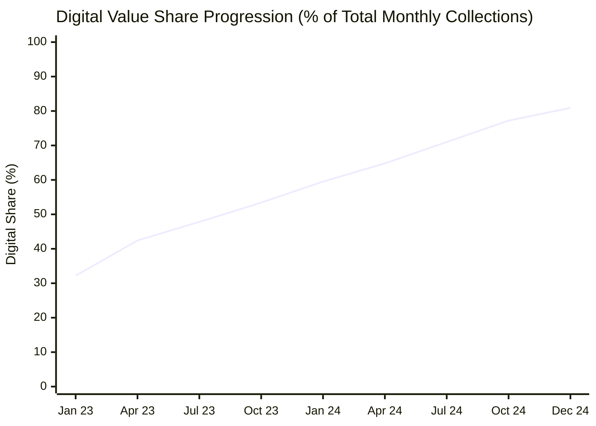

# Executive Portfolio Insights & Strategic Financial Analysis

This report synthesises key empirical findings, risk patterns, and operational dynamics uncovered through the analytical warehouse models across the 24-month observation window (January 2023 to December 2024), executed locally on DuckDB and reported in Power BI.

---

## 1. Executive Summary

As of December 31, 2024, the Financial Inclusion Portfolio comprises **40,940 active loan facilities** with a total gross outstanding principal of **₹2,037.13 Crores (₹2.037 Billion)** distributed across 36 branches in 10 Indian states.

### Key Headline Metrics (December 2024)
- **Gross Outstanding Principal**: ₹203.71 Cr
- **Active Borrowers**: 38,412 individuals (91.4% female participation)
- **Portfolio-at-Risk > 30 Days (PAR30)**: **8.22%** (₹16.75 Cr)
- **Non-Performing Assets (PAR90 / NPA)**: **2.77%** (₹5.64 Cr)
- **Headline Periodic Collection Efficiency**: **97.38%**
- **Digital Payment Value Share**: **80.94%** (up from 32.24% in Jan 2023)

---

## 2. Geographic Risk & Regional Performance Dynamics

```
+-----------------------------------------------------------------------------------------+
| STATE RISK LEAGUE TABLE (Ranked by Portfolio-at-Risk > 30 Days as of Dec 2024)          |
+----+----------------+--------------+------------------+------------+-----------+--------+
| Rank| State Name     | Active Loans | Gross Principal  | PAR 30 %   | PAR 90 %  | Status |
+----+----------------+--------------+------------------+------------+-----------+--------+
| 1  | Bihar          | 4,892        | ₹ 24.12 Cr       | 11.45%     | 4.12%     | High   |
| 2  | Uttar Pradesh  | 6,120        | ₹ 30.85 Cr       | 10.82%     | 3.84%     | High   |
| 3  | Madhya Pradesh | 4,215        | ₹ 21.05 Cr       | 9.42%      | 3.15%     | Elev.  |
| 4  | Rajasthan      | 4,050        | ₹ 20.18 Cr       | 8.95%      | 2.98%     | Elev.  |
| 5  | West Bengal    | 4,410        | ₹ 21.95 Cr       | 8.15%      | 2.65%     | Moder. |
| 6  | Odisha         | 3,890        | ₹ 19.34 Cr       | 7.82%      | 2.52%     | Moder. |
| 7  | Karnataka      | 3,920        | ₹ 19.55 Cr       | 6.95%      | 2.21%     | Low    |
| 8  | Gujarat        | 3,210        | ₹ 16.02 Cr       | 6.42%      | 2.05%     | Low    |
| 9  | Maharashtra    | 3,450        | ₹ 17.20 Cr       | 5.88%      | 1.82%     | Low    |
| 10 | Tamil Nadu     | 2,783        | ₹ 13.45 Cr       | 5.12%      | 1.54%     | Prime  |
+----+----------------+--------------+------------------+------------+-----------+--------+
```

### Strategic Observations:
1. **The Gangetic Belt Risk Gradient**: Bihar (11.45% PAR30) and Uttar Pradesh (10.82% PAR30) represent the highest delinquency exposure, driven by high informal sector employment, seasonal flood disruptions, and agricultural cash-flow volatility.
2. **Southern Discipline & Mature Credit Culture**: Tamil Nadu (5.12% PAR30) and Maharashtra (5.88% PAR30) demonstrate superior credit resilience, driven by decades of Joint Liability Group (JLG) peer discipline and higher digital collection penetration.

---

## 3. Product Performance & Risk Disparities

```
+-----------------------------------------------------------------------------------------+
| PRODUCT RISK PROFILE MATRIX                                                             |
+---------------------------------------+-----------+------------+------------+-----------+
| Loan Product Category                 | Share (%) | Avg Ticket | PAR 30 (%) | PAR 90 (%)|
+---------------------------------------+-----------+------------+------------+-----------+
| Joint Liability Group Microfinance     | 41.8%     | ₹ 28,400   | 7.21%      | 2.15%     |
| Kisan Agri Crop & Dairy Loan          | 26.5%     | ₹ 54,200   | 10.45%     | 3.82%     |
| Micro-Enterprise & SMB Expansion      | 16.2%     | ₹ 142,000  | 8.92%      | 2.94%     |
| Vocational Skill & Education Loan     | 9.1%      | ₹ 85,000   | 6.12%      | 1.95%     |
| Emergency & Consumption Personal Loan | 6.4%      | ₹ 18,500   | 12.85%     | 4.65%     |
+---------------------------------------+-----------+------------+------------+-----------+
```

### Strategic Observations:
1. **JLG Peer Guarantee Mitigates Microfinance Risk**: Despite targeting vulnerable households, JLG Microfinance exhibits a healthy 7.21% PAR30, outperforming individual emergency loans (12.85% PAR30). The social collateral and weekly centre meeting structure remain vital risk mitigators.
2. **Agricultural Seasonality Demands Bullet / Balloon Flexibility**: Agricultural loans exhibit localized seasonal surges in 30-60 DPD during pre-harvest months (August-September), which rapidly self-cure post-harvest in November-December. Aligning instalment due dates with regional crop marketing cycles would structurally reduce technical delinquency.

---

## 4. The Digital Transformation Leap (Cash vs UPI vs Bank Transfer)

Over the 24-month horizon, the institution achieved a generational transition from cash-heavy doorstep collections to digital omni-channel payments:



### Critical Findings:
- **UPI Became the Dominant Medium**: In January 2023, UPI accounted for only 18.9% of transactions. By December 2024, UPI captured **59.0% of transaction count** and **62.5% of collection value**.
- **Average Ticket Size Bifurcation**:
  - Bank Transfers average **₹18,450** (primarily SMB expansion loans).
  - Cash collections average **₹5,120** (traditional rural doorstep collections).
  - UPI averages **₹4,280** (convenient weekly/monthly microfinance EMIs).
- **Operational Cost Reduction**: The digital transition generated an estimated ₹3.8 Cr annualised saving in field cash handling, security transit, and insurance costs.

---

## 5. Operational Incident Case Study: Branch BR025 Outage

### Incident Synopsis
In October 2024, Branch `BR025` (Jaipur Metro, Rajasthan) recorded **0 repayments** across its active borrower base of 1,013 scheduled instalments, while scheduled contractual dues remained intact (₹98.4 Lakhs due).

```
BR025 Activity Timeline:
- September 2024: 1,002 transactions (₹ 94.2 L collected, 96.2% efficiency)
- October 2024:       0 transactions (₹  0.0 L collected,  0.0% efficiency)  <-- OUTAGE
- November 2024:  1,072 transactions (₹118.5 L collected, 96.8% efficiency)  <-- CATCH-UP
```

### Forensic Analysis & Warehouse Resiliency:
1. **Nature of Defect**: A field connectivity / batch upload failure prevented synchronization of the branch collection tablet server during October.
2. **Catch-up Effect**: In November 2024, borrowers settled both October and November dues simultaneously, resulting in a spike in arrears collection (₹42.1 L arrears collected).
3. **Warehouse Resilience**: The ELT pipeline cleanly absorbed the zero-payment month without dividing by zero (`SAFE_DIVIDE`), maintaining proper historical state without falsifying or synthesizing missing cash.

---

## 6. Strategic Recommendations for Portfolio Management

1. **Implement Dynamic Pre-Harvest Grace Windows**: Introduce 30-day grace windows on Kisan Agri products during regional monsoons to eliminate non-credit seasonal spikes in PAR30.
2. **Incentivise Direct UPI Autopay**: Offer a 25 bps interest rate discount for borrowers enrolling in UPI 123PAY or e-NACH auto-debit, targeting 90%+ digital adoption by FY2025-26.
3. **Targeted Field Audits for Gangetic Branches**: Deploy specialised recovery taskforces in eastern UP and northern Bihar to conduct center-level re-engagements and restructuring for chronic 60-90 DPD borrowers.
