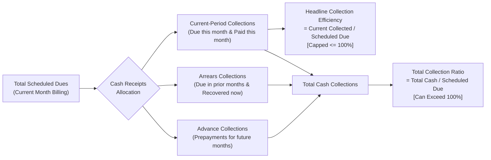

# Financial Key Performance Indicator (KPI) Definitions & Mathematical Standards

This document establishes the official mathematical definitions, accounting boundaries, edge-case rules, and financial interpretations implemented across the analytical warehouse models and Power BI measures.

---

## Executive KPI Reference Matrix

| Metric Name | Formula | Numerator | Denominator | Unit | Financial Interpretation |
|:---|:---|:---|:---|:---:|:---|
| **Gross Outstanding Principal** | $\sum P_{\text{disbursed}} - \sum P_{\text{principal\_paid}}$ | Remaining unpaid loan principal owed across active loans | N/A (Absolute sum) | **Currency (₹ INR)** | Total capital deployed and at risk across active, open borrower accounts at reporting snapshot date. |
| **Portfolio at Risk > 30 Days (PAR 30 %)** | $\frac{\sum P_{\text{gross}}(\text{DPD} > 30)}{\sum P_{\text{gross}}} \times 100$ | Outstanding principal balance of active loans with Days Past Due $> 30$ days | Total gross outstanding principal of all active loans at snapshot date | **Percentage (%)** | Early-warning indicator of portfolio delinquency and asset quality deterioration beyond the 30-day grace period. |
| **Portfolio at Risk > 90 Days (PAR 90 % / Gross NPA)** | $\frac{\sum P_{\text{gross}}(\text{DPD} > 90)}{\sum P_{\text{gross}}} \times 100$ | Outstanding principal balance of active loans with Days Past Due $> 90$ days | Total gross outstanding principal of all active loans at snapshot date | **Percentage (%)** | Non-performing asset (NPA) ratio indicating severe credit distress, default risk, and capital impairment. |
| **Headline Collection Efficiency %** | $\frac{\text{Current Period Collected}}{\text{Scheduled Amount Due}} \times 100$ | Cash collected in billing month applied to current month contractual instalment dues | Total contractual scheduled instalment dues billed in current month | **Percentage (%)** (Bounded $\le 100\%$) | Measures on-time collection discipline without masking monthly billing shortfalls through arrears or advance prepayments. |
| **Total Collection Ratio %** | $\frac{\text{Current} + \text{Arrears} + \text{Advance}}{\text{Scheduled Amount Due}} \times 100$ | Total gross cash collected from all streams (current dues + overdue arrears + advance prepayments) | Total contractual scheduled instalment dues billed in current month | **Percentage (%)** (Can exceed $100\%$) | Total cash recovery velocity against current billing; values $> 100\%$ indicate significant recovery of prior delinquent arrears. |
| **Digital Collection Value Share %** | $\frac{\text{Digital Collections Value}}{\text{Total Collections Value}} \times 100$ | Total rupee value of collections received via digital payment channels (UPI + Net Banking) | Total rupee value of all collections received across all payment channels (Cash + UPI + Net Banking) | **Percentage (%)** | Tracks payment channel transformation and cashless migration by value of recovered funds. |
| **Digital Transaction Count Share %** | $\frac{\text{Digital Transaction Count}}{\text{Total Transaction Count}} \times 100$ | Count of repayment transactions processed via digital payment channels (UPI + Net Banking) | Total count of repayment transactions processed across all payment channels | **Percentage (%)** | Operational indicator of borrower digital engagement and transaction frequency migration away from physical cash. |
| **Average Digital Ticket Size** | $\frac{\text{Digital Collections Value}}{\text{Digital Transaction Count}}$ | Total rupee value of collections received via digital channels (UPI + Net Banking) | Total count of transactions processed via digital channels (UPI + Net Banking) | **Currency (₹ INR / txn)** | Average financial value settled per digital repayment transaction; reflects borrower repayment capacity on digital rails. |
| **Vintage Repayment Rate %** | $\frac{\text{Cumulative Paid at MOB } k}{\text{Cumulative Due at MOB } k} \times 100$ | Cumulative cash repaid by disbursement cohort from origination up to target Month on Book (MOB) $k$ | Cumulative contractual scheduled dues for disbursement cohort up to target Month on Book (MOB) $k$ | **Percentage (%)** | Longitudinal cohort repayment health over loan tenure (MOB 1 to 24), evaluated at target MOB without multi-MOB double counting. |
| **Data Quality Pass Rate %** | $\frac{\text{Clean Payloads Ingested}}{\text{Total Payloads Received}} \times 100$ | Total clean records passing all validation rules and ingested into warehouse (`fact_payment`) | Total raw ingestion records processed (`fact_payment` + `stg_quarantined_records`) | **Percentage (%)** | Ingestion firewall efficacy; measures the proportion of source payloads verified clean for analytical reporting. |

---

## 1. Portfolio Health & Risk KPIs

### 1.1 Gross Outstanding Principal ($P_{\text{gross}}$)
- **Mathematical Definition**: For any reporting snapshot date $t$, the remaining unpaid loan principal owed across all disbursed, active loans:
  $$P_{\text{gross}}(t) = \sum_{i \in \text{Active}(t)} \max\left(0, P_{\text{disbursed}, i} - \sum_{k: \tau_k \le t} p_{\text{principal}, i, k}\right)$$
  where $P_{\text{disbursed}, i}$ is the original principal disbursed, and $p_{\text{principal}, i, k}$ is the principal component of allocation $k$ made on or before snapshot date $t$.
- **Benchmark (2024-12-31)**: **₹2,037,126,496.49** (₹203.71 Cr).

### 1.2 Days Past Due ($\text{DPD}$)
- **Mathematical Definition**: The number of calendar days elapsed between snapshot date $t$ and the earliest unpaid contractual instalment due date $D_{\text{earliest}}$:
  $$\text{DPD}_i(t) = \begin{cases} 
  \max\left(0, t - D_{\text{earliest}, i}\right) & \text{if } \exists \, j \text{ with } D_{i, j} \le t \text{ and } (A_{\text{due}, i, j} - A_{\text{paid}, i, j}(t)) > \epsilon \\
  0 & \text{otherwise}
  \end{cases}$$
- **Internal Operational Rounding Tolerance ($\epsilon$)**: $\epsilon = \text{₹}0.01$. Unpaid balances $\le \text{₹}0.01$ resulting from floating-point or amortisation rounding are deemed immaterial and do not trigger delinquency. This is strictly an internal operational rounding tolerance threshold to eliminate binary floating-point artifacts and is not based on or claimed to be a regulatory mandate.
- **Exclusion of Future Dues**: Any instalment where $D_{i, j} > t$ is strictly excluded from $\text{DPD}$ evaluation.

### 1.3 Portfolio at Risk > 30 Days ($\text{PAR30}$)
- **Mathematical Definition**:
  $$\text{PAR30}(t) = \frac{\sum_{i \in \text{Active}(t), \, \text{DPD}_i(t) > 30} P_{\text{gross}, i}(t)}{\sum_{i \in \text{Active}(t)} P_{\text{gross}, i}(t)} \times 100\%$$
- **Institutional Benchmark (2024-12-31)**: **8.2211%** (₹167,472,997.52 delinquent principal out of ₹2.037B total).

### 1.4 Portfolio at Risk > 90 Days ($\text{PAR90}$ / NPA)
- **Mathematical Definition**:
  $$\text{PAR90}(t) = \frac{\sum_{i \in \text{Active}(t), \, \text{DPD}_i(t) > 90} P_{\text{gross}, i}(t)}{\sum_{i \in \text{Active}(t)} P_{\text{gross}, i}(t)} \times 100\%$$
- **Institutional Benchmark (2024-12-31)**: **2.7686%** (₹56,400,240.18 non-performing principal).

---

## 2. Collection Efficiency Disaggregation & Headline Metric

Financial inclusion institutions must clearly distinguish between **current billing performance** and **gross cash recovery**.

### 2.1 Headline Collection Efficiency ($\text{CE}_{\text{headline}}$)
- **Formal Definition**: The proportion of current-month contractual scheduled billing collected within that same billing month:
  $$\text{CE}_{\text{headline}}(m) = \frac{\text{Current Period Billing Collected}(m)}{\text{Scheduled Amount Due}(m)} \times 100\%$$
- **Business Rationale**: This is the primary operational metric monitored by credit risk and branch operations because it measures on-time repayment discipline without masking monthly billing shortfalls through aggressive arrears collection or advance prepayments.
- **Range**: Strictly bounded between $0.00\%$ and $100.00\%$.

### 2.2 Arrears Collection Recovery
- **Formal Definition**: Cash collected in month $m$ applied against instalments whose contractual due date fell in a prior month ($D_{i, j} < \text{Month}(m)$).

### 2.3 Advance Collections (Prepayments)
- **Formal Definition**: Cash collected in month $m$ applied against future contractual instalments ($D_{i, j} > \text{Month}(m)$).

### 2.4 Total Collection Ratio ($\text{CR}_{\text{total}}$)
- **Formal Definition**: Total cash collected from all three streams divided by current scheduled billing:
  $$\text{CR}_{\text{total}}(m) = \frac{\text{Current Collected}(m) + \text{Arrears Collected}(m) + \text{Advance Collected}(m)}{\text{Scheduled Amount Due}(m)} \times 100\%$$
- **Interpretation**: Can legitimately exceed $100.0\%$ during high-recovery periods (e.g. post-harvest recovery where overdue arrears are settled in lump sums).

---

## 3. Repayment Vintage Analysis (Cohort Loss & Payoff)

### 3.1 Disbursement Cohort ($C$)
- All loans disbursed within the same calendar month $C = \text{YYYY-MM}$.

### 3.2 Month on Book ($\text{MOB}$)
- Integer index $k \ge 1$ representing the number of elapsed months since loan disbursement:
  $$\text{MOB} = 1 + \text{DATE\_DIFF}(\text{snapshot\_month}, \text{disbursement\_month}, \text{MONTH})$$

### 3.3 Cumulative Vintage Repayment Rate ($\text{VRR}$)
- **Mathematical Definition**:
  $$\text{VRR}(C, k) = \frac{\sum_{m \le k} \text{Amount Paid}(C, m)}{\sum_{m \le k} \text{Scheduled Due}(C, m)} \times 100\%$$
- Evaluates seasoning credit deterioration: higher-quality cohorts exhibit flat or gradual decay (e.g. $99.1\% \to 95.5\%$), whereas deteriorating cohorts exhibit steep drop-offs past MOB 6.

---

## 4. Digital Collections & Payment Channel Transformation

### 4.1 Digital Collection Value Share ($\text{DVS}$)
- **Mathematical Definition**:
  $$\text{DVS}(m) = \frac{\text{UPI Collection Value}(m) + \text{Bank Transfer Value}(m)}{\text{Total Collection Value}(m)} \times 100\%$$
- **24-Month Trajectory**: Grew from **32.24%** (Jan 2023) to **80.94%** (Dec 2024), representing a $+48.70$ percentage-point digital leap.

### 4.2 Digital Transaction Count Share ($\text{DCS}$)
- **Mathematical Definition**:
  $$\text{DCS}(m) = \frac{\text{UPI Txn Count}(m) + \text{Bank Transfer Txn Count}(m)}{\text{Total Txn Count}(m)} \times 100\%$$

### 4.3 Month-over-Month ($\text{MoM}$) & Year-over-Year ($\text{YoY}$) Growth
- **MoM Share Change (pts)**: $\text{DVS}(m) - \text{DVS}(m - 1)$
- **YoY Growth Rate (%)**: $\frac{\text{Digital Value}(m) - \text{Digital Value}(m - 12)}{\text{Digital Value}(m - 12)} \times 100\%$

---

## 5. Indian Financial Year Standards

- **Fiscal Year Definition**: April 1 to March 31 of the following calendar year.
- **Quarterly Alignment**:
  - **Q1 (Apr - Jun)**: Agricultural Kharif sowing season.
  - **Q2 (Jul - Sep)**: Monsoon cultivation period.
  - **Q3 (Oct - Dec)**: Kharif harvest and festive recovery season.
  - **Q4 (Jan - Mar)**: Rabi crop maturity and fiscal closing.
