# Power BI Semantic Model Design — Fact Constellation with Conformed Dimensions

## 1. Architectural Overview

The **Financial Inclusion Analytics Warehouse** semantic model is architected as an enterprise **Fact Constellation** (also known as a shared-dimension multi-fact star schema). 

In this architecture:
- Multiple transactional, periodic snapshot, and accumulating fact tables share a core set of **conformed dimensions** (`dim_date`, `dim_branch`, `dim_state`, `dim_product`, `dim_borrower_segment`, `dim_loan`).
- Every relationship follows **strict single-direction 1-to-many filtering** from dimension (one side) to fact (many side).
- There are **zero direct fact-to-fact relationships**.
- There are **zero many-to-many relationships**.
- There are **zero ambiguous active relationship paths**.

```mermaid
erDiagram
    dim_date ||--o{ fact_payment : "1:N (payment_date_key) [ACTIVE]"
    dim_date ||--o{ fact_loan_monthly : "1:N (snapshot_date_key) [INACTIVE]"
    dim_date ||--o{ fact_instalment_allocation : "1:N (due_date_key) [INACTIVE]"
    dim_date ||--o{ fact_instalment_allocation : "1:N (payment_date_key) [INACTIVE]"
    dim_date ||--o{ dim_loan : "1:N (disbursement_date_key) [INACTIVE]"

    dim_branch ||--o{ fact_payment : "1:N (branch_key) [ACTIVE]"
    dim_branch ||--o{ fact_loan_monthly : "1:N (branch_key) [ACTIVE]"
    dim_branch ||--o{ fact_instalment_allocation : "1:N (branch_key) [ACTIVE]"

    dim_state ||--o{ fact_payment : "1:N (state_key) [ACTIVE]"
    dim_state ||--o{ fact_loan_monthly : "1:N (state_key) [ACTIVE]"
    dim_state ||--o{ fact_instalment_allocation : "1:N (state_key) [ACTIVE]"

    dim_product ||--o{ fact_payment : "1:N (product_key) [ACTIVE]"
    dim_product ||--o{ fact_loan_monthly : "1:N (product_key) [ACTIVE]"
    dim_product ||--o{ fact_instalment_allocation : "1:N (product_key) [ACTIVE]"

    dim_borrower_segment ||--o{ fact_payment : "1:N (borrower_segment_key) [ACTIVE]"
    dim_borrower_segment ||--o{ fact_loan_monthly : "1:N (borrower_segment_key) [ACTIVE]"

    dim_loan ||--o{ fact_payment : "1:N (loan_key) [ACTIVE]"
    dim_loan ||--o{ fact_loan_monthly : "1:N (loan_key) [ACTIVE]"
    dim_loan ||--o{ fact_instalment_allocation : "1:N (loan_key) [ACTIVE]"

    dim_date ||--o{ kpi_portfolio_health : "1:N (snapshot_date_key) [ACTIVE]"
    dim_branch ||--o{ kpi_portfolio_health : "1:N (branch_id) [ACTIVE]"
    dim_product ||--o{ kpi_portfolio_health : "1:N (product_id) [ACTIVE]"
    dim_state ||--o{ kpi_portfolio_health : "1:N (state_id) [ACTIVE]"

    dim_date ||--o{ kpi_collection_efficiency : "1:N (month_date_key) [ACTIVE]"
    dim_branch ||--o{ kpi_collection_efficiency : "1:N (branch_id) [ACTIVE]"
    dim_product ||--o{ kpi_collection_efficiency : "1:N (product_id) [ACTIVE]"
    dim_state ||--o{ kpi_collection_efficiency : "1:N (state_id) [ACTIVE]"

    dim_date ||--o{ kpi_digital_collections : "1:N (month_date_key) [ACTIVE]"
    dim_state ||--o{ kpi_digital_collections : "1:N (state_id) [ACTIVE]"

    dim_date ||--o{ kpi_vintage_curves : "1:N (cohort_date_key) [ACTIVE]"
    dim_product ||--o{ kpi_vintage_curves : "1:N (product_id) [ACTIVE]"
```

---

## 2. Dimension Tables & Key Specifications

All dimension primary keys have been audited and verified as strictly non-null and 100% unique across all 1,900,000+ warehouse records.

| Dimension Table | Primary Key | Alternate Business Key | Grain & Scope | Key Attributes |
|:---|:---|:---|:---|:---|
| **`dim_date`** | `date_key` (e.g. `20241231`) | `full_date` (ISO Date) | One row per calendar day (2021-01-01 to 2025-12-31, 1,826 days) | Day, Month Number, Month Name, Quarter, Year-Month, Financial Year (`FY 2024-25`), Financial Quarter, Weekend Flag, Month-End Flag |
| **`dim_loan`** | `loan_key` (Surrogate Int64) | `loan_id` (e.g. `LN000001`) | One row per originated loan contract (52,001 rows) | Borrower ID, Disbursement Date, Principal Amount, Annual Interest Rate, Tenure Months, Loan Status |
| **`dim_branch`** | `branch_key` (Surrogate Int64) | `branch_id` (e.g. `BR001`) | One row per institutional branch office (37 rows) | Branch Name, State ID, Location Type (Rural, Semi-Urban, Urban) |
| **`dim_state`** | `state_key` (Surrogate Int64) | `state_id` (e.g. `ST_MH`) | One row per operational Indian State (11 rows) | State Name, Geographic Region (North, South, East, West, Central) |
| **`dim_product`** | `product_key` (Surrogate Int64) | `product_id` (e.g. `PRD_AGR`) | One row per credit product program (6 rows) | Product Name, Product Category, Interest Rate Min/Max, Tenure Min/Max |
| **`dim_borrower_segment`** | `borrower_segment_key` (Int64) | `borrower_segment` | One row per unique socioeconomic cohort (301 rows) | Income Band, Location Type, Occupation Category |

---

## 3. Fact Tables & Grain Specifications

| Fact Table | Grain | Primary Key | Foreign Keys to Conformed Dimensions | Financial Metrics |
|:---|:---|:---|:---|:---|
| **`fact_payment`** | One row per borrower cash repayment transaction | `payment_key` | `payment_date_key` $\to$ `dim_date` `loan_key` $\to$ `dim_loan` `branch_key` $\to$ `dim_branch` `product_key` $\to$ `dim_product` `state_key` $\to$ `dim_state` `borrower_segment_key` $\to$ `dim_borrower_segment` | `payment_amount` (Normalised INR), `payment_channel` (UPI, Cash, Bank Transfer), `raw_payment_amount`, `raw_amount_unit` |
| **`fact_loan_monthly`** | One row per loan account per month-end snapshot valuation | `snapshot_key` | `snapshot_date_key` $\to$ `dim_date` (Inactive) `loan_key` $\to$ `dim_loan` `branch_key` $\to$ `dim_branch` `product_key` $\to$ `dim_product` `state_key` $\to$ `dim_state` `borrower_segment_key` $\to$ `dim_borrower_segment` | `outstanding_principal`, `instalments_due`, `instalments_paid`, `amount_due`, `amount_paid`, `days_past_due` (DPD), `overdue_amount` |
| **`fact_instalment_allocation`** | One row per payment-to-instalment FIFO waterfall allocation | `allocation_key` | `due_date_key` $\to$ `dim_date` (Inactive) `payment_date_key` $\to$ `dim_date` (Inactive) `loan_key` $\to$ `dim_loan` `branch_key` $\to$ `dim_branch` `product_key` $\to$ `dim_product` `state_key` $\to$ `dim_state` | `allocated_amount`, `allocated_principal`, `allocated_interest`, `instalment_number`, `payment_channel` |

---

## 4. Branch and State Modeling: Independent Conformed Dimensions

A deliberate architectural decision was made regarding `dim_branch` and `dim_state`:
- **Selected Design**: **Independent Conformed Dimensions** (Both `dim_branch` and `dim_state` connect directly to the fact tables).
- **Alternative Considered**: Snowflaking `dim_state` into `dim_branch` (`dim_state` $\to$ `dim_branch` $\to$ Facts).
- **Why Independent Conformed Dimensions Were Chosen**:
  1. All three fact tables already store both `branch_key` and `state_key` natively.
  2. If `dim_state` connected to `dim_branch` while fact tables also connected to `dim_state`, Power BI would report a **diamond ambiguity cycle** (`dim_state` $\to$ `fact` vs `dim_state` $\to$ `dim_branch` $\to$ `fact`).
  3. Having direct relationships allows users to slice fact tables directly by State and Region without forcing query scans across the branch dimension.
  4. There is **zero relationship** between `dim_branch` and `dim_state` in the model, completely preventing any snowflake ambiguity.

---

## 5. Date Role Architecture & Single Active Date Enforcement

To satisfy Key Design Note 2 of the institutional model reference:
> *"Single active date per fact: `fact_payment` $\to$ Payment Date (active), `fact_instalment_allocation` $\to$ Due Date (inactive), `fact_loan_monthly` $\to$ Snapshot Date (inactive), `dim_loan` $\to$ Disbursement Date (inactive)"*

### Date Role Matrix:

| Table | Date Field | Role Name | Relationship Status | Analytical Purpose & DAX Usage |
|:---|:---|:---|:---:|:---|
| `fact_payment` | `payment_date_key` | **Payment Date** | **Active** | Primary operational timeline. Slicing on calendar year or month filters realized cash collections naturally. |
| `fact_loan_monthly` | `snapshot_date_key` | **Snapshot Date** | **Inactive** | Point-in-time portfolio valuation. Activated in portfolio measures using `USERELATIONSHIP(fact_loan_monthly[snapshot_date_key], dim_date[date_key])`. |
| `fact_instalment_allocation` | `due_date_key` | **Due Date** | **Inactive** | Contractual billing schedule. Activated via `USERELATIONSHIP(fact_instalment_allocation[due_date_key], dim_date[date_key])`. |
| `fact_instalment_allocation` | `payment_date_key` | **Allocation Payment Date** | **Inactive** | Timing of cash application. Activated via `USERELATIONSHIP(fact_instalment_allocation[payment_date_key], dim_date[date_key])`. |
| `dim_loan` | `disbursement_date_key`| **Disbursement Date** | **Inactive** | Capital origination event. Activated in origination measures via `USERELATIONSHIP(dim_loan[disbursement_date_key], dim_date[date_key])`. |
| `kpi_portfolio_health` | `snapshot_date_key` | **Reporting Snapshot** | **Active** | Aggregate monthly risk positions. |
| `kpi_collection_efficiency` | `month_date_key` | **Billing Month** | **Active** | Aggregate monthly recovery efficiency. |
| `kpi_digital_collections` | `month_date_key` | **Channel Month** | **Active** | Aggregate monthly channel transition. |
| `kpi_vintage_curves` | `cohort_date_key` | **Cohort Month** | **Active** | Disbursement vintage origination. |

---

## 6. KPI Aggregate Tables & Grain Reconciliation

The four pre-calculated KPI aggregation tables optimize dashboard responsiveness while preserving exact analytical reconciliation with warehouse benchmarks.

| KPI Table | Grain | Row Count | Compatible Dimension Keys | Missing Keys & Structural Limitations |
|:---|:---|:---:|:---|:---|
| **`kpi_portfolio_health`** | Month $\times$ Branch $\times$ Product $\times$ Segment | 24,769 | `snapshot_date_key` $\to$ `dim_date` `branch_id` $\to$ `dim_branch` `product_id` $\to$ `dim_product` `state_id` $\to$ `dim_state` | All primary institutional slicers supported at this grain. |
| **`kpi_collection_efficiency`**| Month $\times$ Branch $\times$ Product | 6,042 | `month_date_key` $\to$ `dim_date` `branch_id` $\to$ `dim_branch` `product_id` $\to$ `dim_product` `state_id` $\to$ `dim_state` | Borrower segment is not tracked in collection billing schedules. |
| **`kpi_digital_collections`** | Month $\times$ State | 260 | `month_date_key` $\to$ `dim_date` `state_id` $\to$ `dim_state` | **`branch_id` is missing by design**: Digital channel adoption is aggregated at the State level across payment rails (UPI, Cash, Bank Transfer). A relationship to `dim_branch` cannot be established. |
| **`kpi_vintage_curves`** | Cohort Month $\times$ Product $\times$ Month-on-Book | 1,641 | `cohort_date_key` $\to$ `dim_date` `product_id` $\to$ `dim_product` | **`branch_id` and `state_id` are missing by design**: Credit vintages track loan portfolio seasoning by product cohort over 1 to 24 months on book. Slicing by branch or geography is not supported at this grain. |
