# Power BI Semantic Model Design — Fact Constellation (Galaxy Schema) Architecture

## 1. Architectural Overview & Design Rationale

The **Financial Inclusion Analytics Warehouse** semantic model is architected as an enterprise **Fact Constellation** (also known as a **Galaxy Schema**). 

### Why a Fact Constellation?
In microfinance and financial inclusion lending, business operations encompass distinct business processes that operate at fundamentally different grains, timeframes, and levels of aggregation:
1. **Cash Transactions**: Individual collection events occurring in real time or daily batches across physical and digital channels.
2. **Accounting Allocations**: FIFO waterfall allocations that split collected cash across specific repayment schedule instalments, principal, interest, and fee obligations.
3. **Portfolio Snapshots**: End-of-month book closures that capture account-level point-in-time risk posture, Days Past Due (DPD), and Portfolio at Risk (PAR) classifications.

Forcing these three distinct processes into a single monolithic fact table would violate Kimball dimensional modeling principles, causing massive grain distortion, sparse null columns, fan-out cartesian traps, and inaccurate financial calculations. 

Instead, the semantic model implements **Three Analytical Star Schemas** sharing a unified suite of **Conformed Dimensions**, supplemented by **Pre-Aggregated KPI Tables** and **Disconnected Supporting Tables**.

```
+---------------------------------------------------------------------------------------------------+
|                                  FACT CONSTELLATION ARCHITECTURE                                  |
+---------------------------------------------------------------------------------------------------+
|                                                                                                   |
|   +-----------------------+     +-----------------------+     +-------------------------------+   |
|   |        STAR 1         |     |        STAR 2         |     |            STAR 3             |   |
|   |   Payment Analytics   |     | Instalment Allocation |     |      Portfolio Analytics      |   |
|   |    (fact_payment)     |     | (fact_instalment_all) |     |      (fact_loan_monthly)      |   |
|   |  Grain: 1 row/payment |     |  Grain: 1 row/alloc   |     |     Grain: 1 row/loan/month   |   |
|   +-----------+-----------+     +-----------+-----------+     +---------------+---------------+   |
|               |                             |                                 |                   |
|               +----------------------+      |      +--------------------------+                   |
|                                      |      |      |                                              |
|                                      v      v      v                                              |
|   +-------------------------------------------------------------------------------------------+   |
|   |                                SHARED CONFORMED DIMENSIONS                                |   |
|   |    dim_date  |  dim_branch  |  dim_state  |  dim_product  |  dim_borrower_segment  | dim_loan |   |
|   +-------------------------------------------------------------------------------------------+   |
|                                             |                                                     |
|                                             v                                                     |
|   +-------------------------------------------------------------------------------------------+   |
|   |                                PRE-AGGREGATED KPI TABLES                                  |   |
|   |  kpi_portfolio_health | kpi_collection_efficiency | kpi_digital_collections | kpi_vintage_curves|   |
|   +-------------------------------------------------------------------------------------------+   |
|                                                                                                   |
|   +-------------------------------------------------------------------------------------------+   |
|   |                               DISCONNECTED SUPPORTING TABLES                              |   |
|   |                  stg_quarantined_records       |       _Measures                          |   |
|   +-------------------------------------------------------------------------------------------+   |
+---------------------------------------------------------------------------------------------------+
```

---

## 2. The Three Primary Analytical Star Schemas

### Star 1 — Payment Analytics
* **Central Fact Table**: `fact_payment`
* **Source Record Count**: 533,147 rows
* **Primary Key / Grain**: `payment_key` (Composite natural key: 1 row per payment transaction event).
* **Business Process**: Captures every repayment transaction collected through physical branches, field collection agents, and digital channels (UPI, net banking, mobile wallets).
* **Conformed Dimension Connections**:
  * `payment_date_key` -> `dim_date[date_key]` (**ACTIVE**): Primary calendar reporting date for cash collection realization.
  * `loan_key` -> `dim_loan[loan_key]` (**ACTIVE**): Direct link to the borrower's loan account.
  * `branch_key` -> `dim_branch[branch_key]` (**ACTIVE**): Branch responsible for the customer account.
  * `state_key` -> `dim_state[state_key]` (**ACTIVE**): Regional geography.
  * `product_key` -> `dim_product[product_key]` (**ACTIVE**): Credit product line.
  * `borrower_segment_key` -> `dim_borrower_segment[borrower_segment_key]` (**ACTIVE**): Borrower socioeconomic cohort.
* **Core Analytical Capabilities**:
  * Total Payment Value (INR) and Total Transaction Volume.
  * Cash vs. Digital Payment Value and Transaction Shares.
  * Average Payment Size by Channel (`payment_channel`).
  * Daily and Monthly Collection Velocity.

---

### Star 2 — Instalment and Collection Analytics
* **Central Fact Table**: `fact_instalment_allocation`
* **Source Record Count**: 723,600 rows
* **Primary Key / Grain**: `allocation_key` (Composite natural key: 1 row per payment-to-instalment allocation event).
* **Business Process**: Implements the microfinance FIFO waterfall allocation algorithm. When a borrower submits payment, cash is applied sequentially to the oldest outstanding obligation first, split precisely across fee, interest, and principal components.
* **Conformed Dimension Connections**:
  * `due_date_key` -> `dim_date[date_key]` (**INACTIVE**): Scheduled instalment maturity date (activated via DAX `USERELATIONSHIP`).
  * `payment_date_key` -> `dim_date[date_key]` (**INACTIVE**): Date cash was realized (activated via DAX `USERELATIONSHIP`).
  * `loan_key` -> `dim_loan[loan_key]` (**ACTIVE**): Parent loan account.
  * `branch_key` -> `dim_branch[branch_key]` (**ACTIVE**): Branch attribution.
  * `state_key` -> `dim_state[state_key]` (**ACTIVE**): State regional attribution.
  * `product_key` -> `dim_product[product_key]` (**ACTIVE**): Product category.
* **Core Analytical Capabilities**:
  * Allocated Principal vs. Allocated Interest vs. Allocated Fees.
  * Partial payment resolution tracking.
  * Collection performance against scheduled instalment dues.
  * Arrears ageing and waterfall recovery trends.

---

### Star 3 — Portfolio Analytics
* **Central Fact Table**: `fact_loan_monthly`
* **Source Record Count**: 651,542 rows
* **Primary Key / Grain**: `snapshot_key` (Composite natural key: 1 row per loan account per monthly reporting snapshot).
* **Business Process**: Monthly periodic balance sheet closure. Captures the point-in-time risk profile, Days Past Due (DPD) status, overdue balances, and outstanding principal as of each calendar month-end.
* **Point-in-Time Integrity Rule**: Strictly historical. Future payment information beyond the snapshot date is never leaked into historical snapshots.
* **Conformed Dimension Connections**:
  * `snapshot_date_key` -> `dim_date[date_key]` (**INACTIVE**): Snapshot month-end date (activated in DAX via `USERELATIONSHIP` to prevent diamond ambiguity with transaction dates).
  * `loan_key` -> `dim_loan[loan_key]` (**ACTIVE**): Loan account details.
  * `branch_key` -> `dim_branch[branch_key]` (**ACTIVE**): Branch attribution.
  * `state_key` -> `dim_state[state_key]` (**ACTIVE**): State regional attribution.
  * `product_key` -> `dim_product[product_key]` (**ACTIVE**): Loan product line.
  * `borrower_segment_key` -> `dim_borrower_segment[borrower_segment_key]` (**ACTIVE**): Socioeconomic demographic cohort.
* **Core Analytical Capabilities**:
  * Portfolio at Risk: PAR 30 (DPD > 30) and PAR 90 (DPD > 90) balances and percentage rates.
  * Total Active Loans and Total Outstanding Portfolio Balance.
  * Delinquency bucket distribution (Current, DPD 1-30, DPD 31-60, DPD 61-90, DPD 90+).
  * Monthly portfolio quality degradation / curing tracking.

---

## 3. Conformed Dimensions Mapping

The architecture incorporates six conformed dimensions that ensure cross-functional analytical consistency across all three fact tables:

| Dimension Table | Primary Key | Total Rows | Null Count | Unique Status | Key Attributes | Conformed Role |
|:---|:---|:---:|:---:|:---:|:---|:---|
| `dim_date` | `date_key` | 1,826 | 0 | **100% Unique** | `date`, `day`, `month`, `quarter`, `year`, `month_name`, `fiscal_year` | Universal calendar dimension covering 2022-01-01 to 2026-12-31. |
| `dim_state` | `state_key` | 11 | 0 | **100% Unique** | `state_id`, `state_name`, `region` | Conformed state regional hierarchy. |
| `dim_branch` | `branch_key` | 37 | 0 | **100% Unique** | `branch_id`, `branch_name`, `branch_type`, `location_city`, `state_key` | Physical branch footprint across all states. |
| `dim_product` | `product_key` | 6 | 0 | **100% Unique** | `product_id`, `product_name`, `product_type`, `min_tenure`, `max_tenure`, `interest_rate` | Credit product catalog (JLG, Micro Business, Agri, Sanitation, etc.). |
| `dim_borrower_segment`| `borrower_segment_key` | 301 | 0 | **100% Unique** | `segment_name`, `income_band`, `location_type`, `occupation_category` | Borrower demographic and socioeconomic profiles. |
| `dim_loan` | `loan_key` | 52,001 | 0 | **100% Unique** | `loan_id`, `disbursement_date_key`, `loan_amount`, `tenure_months`, `interest_rate` | Core loan contract dimension with point-in-time disbursement parameters. |

All foreign keys across all fact and KPI tables resolve to valid dimension keys with **0 orphan foreign keys**.

---

## 4. Branch and State Modeling Decision

A critical architectural consideration in dimensional modeling is the relationship between `dim_branch` and `dim_state`:

### Evaluated Alternatives
* **Option A — Snowflaked Geography (`dim_state` -> `dim_branch` -> Facts)**:
  In this model, facts only connect to `dim_branch`, and `dim_branch` connects to `dim_state`.
  * *Disadvantage*: In our microfinance warehouse, state-level KPI summary tables (`kpi_digital_collections`) exist at the State level without branch identifiers. Furthermore, snowflake schemas introduce unnecessary join latency and visual clutter.
* **Option B — Parallel Conformed Dimensions (Selected Architecture)**:
  Both `dim_branch` and `dim_state` act as independent, conformed dimensions that directly filter facts and KPI tables.
  * *Implementation*: In `model.bim`, fact tables link directly to `dim_branch[branch_key]` and `dim_state[state_key]`. Crucially, **no relationship exists between `dim_state` and `dim_branch` in `model.bim`**.
  * *Architectural Benefit*: Eliminates the diamond multi-path ambiguity trap (`fact -> branch -> state` vs `fact -> state`). Both state-level and branch-level slicing operate cleanly with strict 1-to-many filtering.

---

## 5. `dim_loan` Relationship Design

`dim_loan` contains loan-level attributes along with descriptive keys (`branch_key`, `product_key`, `borrower_segment_key`, `disbursement_date_key`). 

### Resolution of Duplicate Active Paths
In early prototype builds, `dim_loan` was connected to `dim_branch`, `dim_product`, and `dim_date`, while fact tables were simultaneously connected to both `dim_loan` and those same dimensions. This created classic diamond cycles:
```
fact_payment -> dim_loan -> dim_branch
fact_payment -> dim_branch
```
* **Corrective Action**:
  1. All snowflake relationships on `dim_loan` (`dim_loan` to branch, product, state, and segment) were completely removed from `model.bim`.
  2. `dim_loan` connects directly to each fact table via `loan_key` (1-to-many single direction).
  3. The relationship `dim_loan[disbursement_date_key] -> dim_date[date_key]` is set to **INACTIVE** and activated only in specific origination cohort measures via DAX `USERELATIONSHIP`.

---

## 6. Date Role Management & The Single Active Date Rule

Because microfinance records multiple dates across transaction, schedule, and portfolio lifecycles, date role ambiguity is the most frequent source of tabular engine crashes and ambiguous relationship errors.

### The Single Active Date Rule per Consuming Table
To guarantee deterministic filter propagation and prevent diamond cycle ambiguities, **at most one active relationship to `dim_date` is permitted per consuming fact or pre-aggregated KPI table**:

Across the entire semantic model, there are **9 relationships involving `dim_date`**:
- **5 Active Relationships**: Exactly one active date link for `fact_payment` and each of the four pre-aggregated KPI tables.
- **4 Inactive Relationships**: Secondary date roles activated explicitly in DAX via `USERELATIONSHIP`.

| Consuming Table | Table Type | Date Column (FK) | Date Role | Status | Filter & Activation Mechanism |
|:---|:---|:---|:---|:---:|:---|
| `fact_payment` | Fact (Star 1) | `payment_date_key` | Cash Payment Realization Date | **ACTIVE** | Default engine filter propagation for cash collections |
| `kpi_portfolio_health` | KPI Aggregate | `snapshot_date_key` | Monthly Portfolio Snapshot Date | **ACTIVE** | Default engine filter propagation for portfolio health KPIs |
| `kpi_collection_efficiency` | KPI Aggregate | `month_date_key` | Monthly Collection Performance Period | **ACTIVE** | Default engine filter propagation for monthly efficiency KPIs |
| `kpi_digital_collections` | KPI Aggregate | `month_date_key` | Monthly Digital Channel Performance Period | **ACTIVE** | Default engine filter propagation for digital adoption trends |
| `kpi_vintage_curves` | KPI Aggregate | `cohort_date_key` | Loan Origination / Vintage Cohort Month | **ACTIVE** | Default engine filter propagation for cohort repayment curves |
| `fact_loan_monthly` | Fact (Star 3) | `snapshot_date_key` | Monthly Portfolio Health Reporting Cutoff | **INACTIVE** | Activated explicitly via `USERELATIONSHIP` in portfolio DAX measures |
| `fact_instalment_allocation` | Fact (Star 2) | `due_date_key` | Contractual Instalment Maturity Date | **INACTIVE** | Activated explicitly via `USERELATIONSHIP` in scheduled dues measures |
| `fact_instalment_allocation` | Fact (Star 2) | `payment_date_key` | Cash Allocation Realization Date | **INACTIVE** | Activated explicitly via `USERELATIONSHIP` in allocation recovery measures |
| `dim_loan` | Dimension | `disbursement_date_key` | Loan Origination / Disbursement Date | **INACTIVE** | Activated explicitly via `USERELATIONSHIP` in origination vintage measures |

### Why This Design Prevents Ambiguity
In tabular dimensional modeling:
1. **Fact and KPI Table Isolation**: Fact tables never connect directly to other fact tables, and KPI tables never connect directly to each other. Therefore, having one active date link from `dim_date` to `fact_payment` and one to each KPI table creates parallel star fan-outs without any converging filter loops.
2. **Deactivation of Cross-Entity Date Paths**:
   - `fact_loan_monthly[snapshot_date_key] -> dim_date[date_key]` is set to **Inactive**, preventing competition with `fact_payment` when filtering loans.
   - `dim_loan[disbursement_date_key] -> dim_date[date_key]` is set to **Inactive**, eliminating the classic diamond cycle (`fact_payment -> dim_loan -> dim_date` vs `fact_payment -> dim_date`).
   - `fact_instalment_allocation` date links are set to **Inactive**, preventing ambiguity between instalment due dates and payment realization dates.
3. **Deterministic DAX Activation**: DAX measures explicitly dictate which date context is active at query time using `USERELATIONSHIP`.

### DAX Measure Implementation Example:
```dax
-- Active relationship used by default for payment analysis
[Total Payments INR] = SUM(fact_payment[payment_amount])

-- Inactive relationship explicitly activated for monthly portfolio health
[Active Loans Count] = 
CALCULATE(
    COUNTROWS(fact_loan_monthly),
    fact_loan_monthly[outstanding_principal] > 0,
    USERELATIONSHIP(fact_loan_monthly[snapshot_date_key], dim_date[date_key])
)
```

---

## 7. Pre-Aggregated KPI Tables

The semantic model includes four pre-aggregated summary tables generated by BigQuery warehouse SQL transformations. These tables accelerate high-level executive dashboard visuals while matching underlying fact aggregates to the exact rupee:

| KPI Table | Source Record Count | True Grain (Composite Key) | Dimension Foreign Keys | Incompatible Dimensions (Correctly Excluded) |
|:---|:---:|:---|:---|:---|
| `kpi_portfolio_health` | 24,769 | `(snapshot_date_key, state_id, branch_id, product_id, borrower_segment)` | `snapshot_date_key` -> `dim_date`<br>`branch_id` -> `dim_branch`<br>`product_id` -> `dim_product`<br>`state_id` -> `dim_state` | N/A |
| `kpi_collection_efficiency` | 6,042 | `(month_date_key, state_id, branch_id, product_id)` | `month_date_key` -> `dim_date`<br>`branch_id` -> `dim_branch`<br>`product_id` -> `dim_product`<br>`state_id` -> `dim_state` | `borrower_segment` (not present in efficiency grain) |
| `kpi_digital_collections` | 260 | `(month_date_key, state_id)` | `month_date_key` -> `dim_date`<br>`state_id` -> `dim_state` | `branch_id`, `product_id` (aggregated to State level) |
| `kpi_vintage_curves` | 1,641 | `(cohort_date_key, product_id, month_on_book)` | `cohort_date_key` -> `dim_date`<br>`product_id` -> `dim_product` | `branch_id`, `state_id` (aggregated to Product Cohort level) |

### Double-Counting Prevention
Measures built for transactional reporting query the fact tables (`fact_payment`, `fact_instalment_allocation`, `fact_loan_monthly`). Measures built for aggregate macro trends query the KPI tables. The two grains are never cross-joined in DAX, preventing Cartesian multiplication and inflated totals.

---

## 8. Disconnected Supporting Tables

Two tables in the semantic model intentionally have zero relationships to any other table:

### 1. `stg_quarantined_records` (1,681 rows)
* **Purpose**: Captures corrupted, predated, negative, or duplicate records identified and quarantined by data ingestion quality pipelines.
* **Why Disconnected?**: By definition, quarantined records violate referential integrity or domain constraints (e.g. invalid dates, negative amounts). Connecting this table to conformed dimensions would cause relationship violations or force synthetic surrogate keys.
* **Role**: Powers the standalone **Data Quality Monitoring** dashboard page.

### 2. `_Measures` (37 measures)
* **Purpose**: Centralized DAX measure repository.
* **Why Disconnected?**: Standard enterprise Power BI best practice. Isolating calculation logic into an empty table prevents visual clutter across physical tables.

---

## 9. Visual Layout in Power BI Model View

To ensure instant readability during technical recruitment reviews, tables are organized into 5 functional clusters:

```
+---------------------------------------------------------------------------------------------------------+
|                                  POWER BI MODEL VIEW LOGICAL LAYOUT                                     |
+---------------------------------------------------------------------------------------------------------+
|                                                                                                         |
|   [CONFORMED DIMENSIONS - LEFT COLUMN]             [THREE ANALYTICAL STARS - CENTER]                    |
|   +------------------------------------+           +------------------------------------------+         |
|   | dim_borrower_segment (PK: key)     |           | STAR 1: fact_payment                     |         |
|   +------------------------------------+           | PK: payment_key | Grain: 1 row/payment   |         |
|   +------------------------------------+           +------------------------------------------+         |
|   | dim_product (PK: key, id)          |                                                                |
|   +------------------------------------+           +------------------------------------------+         |
|   +------------------------------------+           | STAR 2: fact_instalment_allocation       |         |
|   | dim_branch (PK: key, id)           |           | PK: allocation_key | Grain: 1 row/alloc  |         |
|   +------------------------------------+           +------------------------------------------+         |
|   +------------------------------------+                                                                |
|   | dim_state (PK: key, id)            |           +------------------------------------------+         |
|   +------------------------------------+           | STAR 3: fact_loan_monthly                |         |
|                                                    | PK: snapshot_key | Grain: 1 row/loan/mo  |         |
|   [CALENDAR & LOAN - TOP CENTER]                   +------------------------------------------+         |
|   +------------------------------------+                                                                |
|   | dim_date (PK: date_key)            |           [PRE-AGGREGATED KPIS - RIGHT COLUMN]                 |
|   +------------------------------------+           +------------------------------------------+         |
|   +------------------------------------+           | kpi_portfolio_health                     |         |
|   | dim_loan (PK: loan_key)            |           +------------------------------------------+         |
|   +------------------------------------+           +------------------------------------------+         |
|                                                    | kpi_collection_efficiency                |         |
|   [SUPPORTING TABLES - BOTTOM CENTER]              +------------------------------------------+         |
|   +------------------------------------+           +------------------------------------------+         |
|   | stg_quarantined_records (DQ Audit) |           | kpi_digital_collections                  |         |
|   +------------------------------------+           +------------------------------------------+         |
|   +------------------------------------+           +------------------------------------------+         |
|   | _Measures (Central DAX Container)  |           | kpi_vintage_curves                       |         |
|   +------------------------------------+           +------------------------------------------+         |
+---------------------------------------------------------------------------------------------------------+
```

---

## 10. Complete Mermaid Architecture Diagram

```mermaid
erDiagram
    dim_date ||--o{ fact_payment : "1:N (payment_date_key) [ACTIVE]"
    dim_date ||--o{ fact_loan_monthly : "1:N (snapshot_date_key) [INACTIVE]"
    dim_date ||--o{ fact_instalment_allocation : "1:N (due_date_key) [INACTIVE]"
    dim_date ||--o{ fact_instalment_allocation : "1:N (payment_date_key) [INACTIVE]"
    dim_date ||--o{ dim_loan : "1:N (disbursement_date_key) [INACTIVE]"
    dim_date ||--o{ kpi_portfolio_health : "1:N (snapshot_date_key) [ACTIVE]"
    dim_date ||--o{ kpi_collection_efficiency : "1:N (month_date_key) [ACTIVE]"
    dim_date ||--o{ kpi_digital_collections : "1:N (month_date_key) [ACTIVE]"
    dim_date ||--o{ kpi_vintage_curves : "1:N (cohort_date_key) [ACTIVE]"

    dim_branch ||--o{ fact_payment : "1:N (branch_key) [ACTIVE]"
    dim_branch ||--o{ fact_loan_monthly : "1:N (branch_key) [ACTIVE]"
    dim_branch ||--o{ fact_instalment_allocation : "1:N (branch_key) [ACTIVE]"
    dim_branch ||--o{ kpi_portfolio_health : "1:N (branch_id) [ACTIVE]"
    dim_branch ||--o{ kpi_collection_efficiency : "1:N (branch_id) [ACTIVE]"

    dim_state ||--o{ fact_payment : "1:N (state_key) [ACTIVE]"
    dim_state ||--o{ fact_loan_monthly : "1:N (state_key) [ACTIVE]"
    dim_state ||--o{ fact_instalment_allocation : "1:N (state_key) [ACTIVE]"
    dim_state ||--o{ kpi_portfolio_health : "1:N (state_id) [ACTIVE]"
    dim_state ||--o{ kpi_collection_efficiency : "1:N (state_id) [ACTIVE]"
    dim_state ||--o{ kpi_digital_collections : "1:N (state_id) [ACTIVE]"

    dim_product ||--o{ fact_payment : "1:N (product_key) [ACTIVE]"
    dim_product ||--o{ fact_loan_monthly : "1:N (product_key) [ACTIVE]"
    dim_product ||--o{ fact_instalment_allocation : "1:N (product_key) [ACTIVE]"
    dim_product ||--o{ kpi_portfolio_health : "1:N (product_id) [ACTIVE]"
    dim_product ||--o{ kpi_collection_efficiency : "1:N (product_id) [ACTIVE]"
    dim_product ||--o{ kpi_vintage_curves : "1:N (product_id) [ACTIVE]"

    dim_borrower_segment ||--o{ fact_payment : "1:N (borrower_segment_key) [ACTIVE]"
    dim_borrower_segment ||--o{ fact_loan_monthly : "1:N (borrower_segment_key) [ACTIVE]"

    dim_loan ||--o{ fact_payment : "1:N (loan_key) [ACTIVE]"
    dim_loan ||--o{ fact_loan_monthly : "1:N (loan_key) [ACTIVE]"
    dim_loan ||--o{ fact_instalment_allocation : "1:N (loan_key) [ACTIVE]"

    stg_quarantined_records {
        string quarantine_id PK
        string source_table
        string reason_code
        string raw_payload
    }

    _Measures {
        string MeasureName
        string DAXExpression
    }
```



---

## 11. Assignment Alignment & Recruitment Delivery Summary

The final architecture directly fulfills all requirements of the recruitment take-home specification:

1. **Portfolio Health & Delinquency**: Fully supported via `fact_loan_monthly` and `kpi_portfolio_health` for accurate PAR 30 and PAR 90 metrics without lookahead bias.
2. **Collection Efficiency**: Fully supported via `fact_instalment_allocation` (FIFO waterfall component analysis) and `kpi_collection_efficiency`.
3. **Channel Performance & Digital Transformation**: Fully supported via `fact_payment` and `kpi_digital_collections`, tracking cash vs digital shares, MoM and YoY growth.
4. **Vintage Curve Cohort Analysis**: Fully supported via `kpi_vintage_curves` and inactive loan disbursement dates.
5. **Data Quality Governance**: Audited via `stg_quarantined_records` without corrupting warehouse financial facts.
