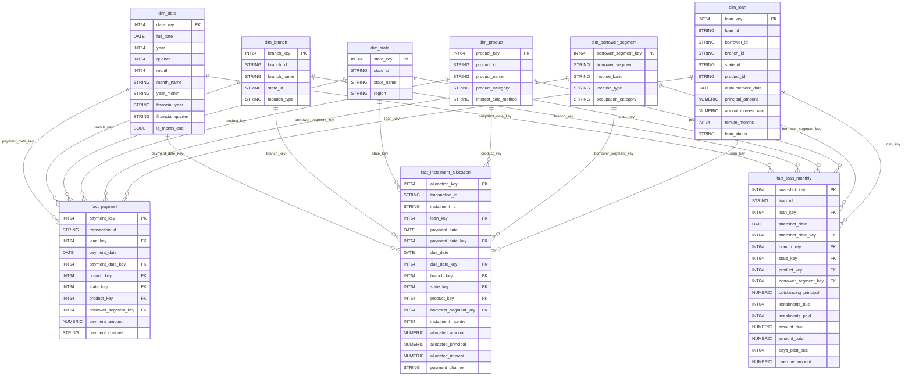

# Star Schema Design & Data Warehouse Dimensional Model

This document outlines the Kimball star schema dimensional architecture implemented in the analytical warehouse (`fin_warehouse`), executed locally via DuckDB (`data/warehouse/financial_inclusion_bigquery.duckdb`) using BigQuery-compatible Standard SQL models. Power BI consumes curated CSV extracts produced by this pipeline.

---

## 1. Dimensional Model Overview

---

## 2. Dimension Tables Specification

### 2.1 `dim_date`
- **Grain**: Exactly one row per calendar day from 2021-01-01 to 2025-12-31 (1,826 days).
- **Primary Key**: `date_key` (Format `YYYYMMDD`, e.g. `20241231`).
- **Special Attributes**: Indian financial year (April 1 to March 31, e.g. `FY2024-25`), `financial_quarter`, `is_month_end` boolean.

### 2.2 `dim_state`
- **Grain**: One row per Indian state in the portfolio operational footprint plus fallback row.
- **Primary Key**: `state_key` (Surrogate integer).
- **Business Key**: `state_id` (e.g. `ST_UP`, `ST_MH`, `ST_BR`).
- **Row Count**: 11 rows (10 operational states + 1 fallback `-1`).

### 2.3 `dim_branch`
- **Grain**: One row per microfinance branch plus fallback row.
- **Primary Key**: `branch_key` (Surrogate integer).
- **Business Key**: `branch_id` (e.g. `BR001` through `BR036`).
- **Row Count**: 37 rows (36 operating branches + 1 fallback `-1`).

### 2.4 `dim_product`
- **Grain**: One row per financial inclusion loan product plus fallback row.
- **Primary Key**: `product_key` (Surrogate integer).
- **Business Key**: `product_id` (`PRD_MFI`, `PRD_AGR`, `PRD_MSME`, `PRD_EDU`, `PRD_EMG`).
- **Row Count**: 6 rows (5 products + 1 fallback `-1`).

### 2.5 `dim_borrower_segment`
- **Grain**: Unique combination of socioeconomic cohort attributes: `borrower_segment`, `income_band`, `location_type`, and `occupation_category`.
- **Primary Key**: `borrower_segment_key` (Surrogate integer).
- **Row Count**: 301 rows.

### 2.6 `dim_loan`
- **Grain**: Exactly one row per unique contracted loan facility.
- **Primary Key**: `loan_key` (Surrogate integer).
- **Business Key**: `loan_id` (e.g. `LN000001` through `LN052000`).
- **Row Count**: 52,001 rows (52,000 valid loans + 1 fallback row).

---

## 3. Fact Tables Specification

### 3.1 `fact_payment` (Transaction Fact)
- **Grain**: Exactly one row per received repayment transaction.
- **Primary Key**: `payment_key` (Surrogate integer).
- **Business Key**: `transaction_id` (e.g. `TXN00000001`).
- **Financial Measures**:
  - `payment_amount` (`DOUBLE` in DuckDB implementation; `DECIMAL(18,2)` targeted in future enhancements): Exact payment amount received in INR.
- **Row Count**: 533,147 rows.
- **Reconciliation Total**: ₹2,414,272,241.51.

### 3.2 `fact_instalment_allocation` (Allocation Sub-Fact)
- **Grain**: Exactly one row per payment allocation leg against a specific scheduled instalment.
- **Primary Key**: `allocation_key` (Surrogate integer).
- **Foreign Keys**: `loan_key`, `payment_date_key`, `due_date_key`, `branch_key`, `state_key`, `product_key`, `borrower_segment_key`.
- **Financial Measures**:
  - `allocated_amount` (`DOUBLE` in DuckDB implementation; `DECIMAL(18,2)` future enhancement): Portioned cash applied to instalment.
  - `allocated_principal` (`DOUBLE` in DuckDB implementation; `DECIMAL(18,2)` future enhancement): Principal component paid.
  - `allocated_interest` (`DOUBLE` in DuckDB implementation; `DECIMAL(18,2)` future enhancement): Interest component paid.
- **Invariant**: `allocated_amount = allocated_principal + allocated_interest`.
- **Row Count**: 723,600 rows.
- **Reconciliation Total**: ₹2,414,272,241.51 (100.0% conservation with `fact_payment`).

### 3.3 `fact_loan_monthly` (Periodic Snapshot Fact)
- **Grain**: Exactly one row per loan per month-end reporting snapshot date.
- **Primary Key**: `snapshot_key` (Surrogate integer) / Composite Key `(loan_id, snapshot_date_key)`.
- **Temporal Coverage**: 24 calendar month-ends (2023-01-31 to 2024-12-31).
- **Financial Measures**:
  - `outstanding_principal` (`DOUBLE` in DuckDB implementation; `DECIMAL(18,2)` future enhancement): Point-in-time remaining principal balance calculated from initial principal minus cumulative principal allocations received on or before snapshot date.
  - `amount_due` (`DECIMAL(38,2)`): Cumulative dues scheduled on or before snapshot date.
  - `amount_paid` (`DOUBLE`): Cumulative payments allocated on or before snapshot date.
  - `days_past_due` (`INT64`): Dynamic days elapsed since oldest unsatisfied instalment due on or before snapshot date (excluding future dues, using internal operational rounding tolerance threshold $\le \text{₹}0.01$).
  - `overdue_amount` (`DOUBLE`): Overdue arrears as of snapshot date.
- **Row Count**: 651,542 rows.

---

## 4. Constraint Enforcement Architecture

In the analytical warehouse implementation:
- **Declarative Engine Constraints**: In DuckDB (and BigQuery CTAS), executing `CREATE OR REPLACE TABLE AS SELECT` creates tables from result set schemas without registering declarative `PRIMARY KEY` or `FOREIGN KEY` constraints in database catalog metadata (`information_schema.table_constraints` is empty). This is standard for OLAP columnar architectures to maintain bulk ingestion throughput.
- **Application & Test Enforcement**: Primary-key uniqueness, foreign-key referential integrity (zero orphan keys), and grain constraints are strictly enforced via upstream SQL window ranking deduplication (`ROW_NUMBER() OVER (...) WHERE rn = 1`), defensive fallback joins (`COALESCE(dim.key, -1)`), and the 64 automated pytest test cases.
- **Pipeline Workflow**: The pipeline executes as a deterministic full-refresh workflow, where each execution cleanly replaces staging, dimensional, fact, and KPI models. Individual models run as standalone DDL statements without a single transaction wrapper.
