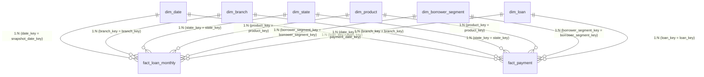

# Power BI Semantic Model Schema & Star Schema Architecture

## 1. Dimensional Model Relationships

---

## 2. Table-by-Table Relationship Registry

| Primary (1) Table | Primary Key | Foreign (*) Table | Foreign Key | Cardinality | Cross-Filter Direction | Active | Security Filtering |
|---|---|---|---|---|---|---|---|
| `dim_date` | `date_key` | `fact_loan_monthly` | `snapshot_date_key` | `1 : *` | Single (`dim_date` filters `fact`) | Yes | No |
| `dim_date` | `date_key` | `fact_payment` | `payment_date_key` | `1 : *` | Single (`dim_date` filters `fact`) | Yes | No |
| `dim_branch` | `branch_key` | `fact_loan_monthly` | `branch_key` | `1 : *` | Single (`dim_branch` filters `fact`) | Yes | Yes (Branch RLS) |
| `dim_branch` | `branch_key` | `fact_payment` | `branch_key` | `1 : *` | Single (`dim_branch` filters `fact`) | Yes | Yes (Branch RLS) |
| `dim_state` | `state_key` | `fact_loan_monthly` | `state_key` | `1 : *` | Single (`dim_state` filters `fact`) | Yes | Yes (Regional RLS) |
| `dim_state` | `state_key` | `fact_payment` | `state_key` | `1 : *` | Single (`dim_state` filters `fact`) | Yes | Yes (Regional RLS) |
| `dim_product` | `product_key` | `fact_loan_monthly` | `product_key` | `1 : *` | Single (`dim_product` filters `fact`) | Yes | No |
| `dim_product` | `product_key` | `fact_payment` | `product_key` | `1 : *` | Single (`dim_product` filters `fact`) | Yes | No |
| `dim_borrower_segment` | `borrower_segment_key` | `fact_loan_monthly` | `borrower_segment_key` | `1 : *` | Single (`dim_borrower_segment` filters `fact`) | Yes | No |
| `dim_borrower_segment` | `borrower_segment_key` | `fact_payment` | `borrower_segment_key` | `1 : *` | Single (`dim_borrower_segment` filters `fact`) | Yes | No |
| `dim_loan` | `loan_key` | `fact_loan_monthly` | `loan_key` | `1 : *` | Single (`dim_loan` filters `fact`) | Yes | No |
| `dim_loan` | `loan_key` | `fact_payment` | `loan_key` | `1 : *` | Single (`dim_loan` filters `fact`) | Yes | No |

---

## 3. Storage Mode & Performance Recommendations

1. **Storage Mode**:
   - **Dimensions (`dim_*`)**: `Dual` or `Import` (low volume, fast in-memory filtering).
   - **Aggregated Analytics Models (`kpi_*`)**: `Import` mode for sub-second dashboard rendering across cards, trends, and matrices.
   - **Granular Fact Tables (`fact_loan_monthly`, `fact_payment`)**: `Import` mode for offline extracts, or `DirectQuery` when connected live to BigQuery with partitioning on `snapshot_date_key` / `payment_date_key`.

2. **Hierarchies Configured in Power BI**:
   - **Date Hierarchy**: `Financial Year` -> `Financial Quarter` -> `Year Month` -> `Date`
   - **Geography Hierarchy**: `Region` -> `State Name` -> `Branch Name`
   - **Product Hierarchy**: `Product Category` -> `Product Name`
   - **Borrower Hierarchy**: `Location Type` -> `Borrower Segment` -> `Income Band`
