# Power BI Semantic Model Schema & Star Schema Architecture

## 1. Dimensional Model Relationships

```mermaid
erDiagram
    dim_date ||--o{ fact_loan_monthly : "1:N (date_key = snapshot_date_key)"
    dim_branch ||--o{ fact_loan_monthly : "1:N (branch_key = branch_key)"
    dim_state ||--o{ fact_loan_monthly : "1:N (state_key = state_key)"
    dim_product ||--o{ fact_loan_monthly : "1:N (product_key = product_key)"
    dim_borrower_segment ||--o{ fact_loan_monthly : "1:N (borrower_segment_key = borrower_segment_key)"
    dim_loan ||--o{ fact_loan_monthly : "1:N (loan_key = loan_key)"
    
    dim_date ||--o{ fact_payment : "1:N (date_key = payment_date_key)"
    dim_branch ||--o{ fact_payment : "1:N (branch_key = branch_key)"
    dim_state ||--o{ fact_payment : "1:N (state_key = state_key)"
    dim_product ||--o{ fact_payment : "1:N (product_key = product_key)"
    dim_borrower_segment ||--o{ fact_payment : "1:N (borrower_segment_key = borrower_segment_key)"
    dim_loan ||--o{ fact_payment : "1:N (loan_key = loan_key)"

    dim_date ||--o{ kpi_portfolio_health : "1:N (date_key = snapshot_date_key)"
    dim_branch ||--o{ kpi_portfolio_health : "1:N (branch_id = branch_id)"
    dim_product ||--o{ kpi_portfolio_health : "1:N (product_id = product_id)"
    dim_state ||--o{ kpi_portfolio_health : "1:N (state_id = state_id)"

    dim_date ||--o{ kpi_collection_efficiency : "1:N (date_key = month_date_key)"
    dim_branch ||--o{ kpi_collection_efficiency : "1:N (branch_id = branch_id)"
    dim_product ||--o{ kpi_collection_efficiency : "1:N (product_id = product_id)"
    dim_state ||--o{ kpi_collection_efficiency : "1:N (state_id = state_id)"

    dim_date ||--o{ kpi_digital_collections : "1:N (date_key = month_date_key)"
    dim_state ||--o{ kpi_digital_collections : "1:N (state_id = state_id)"

    dim_date ||--o{ kpi_vintage_curves : "1:N (date_key = cohort_date_key)"
    dim_product ||--o{ kpi_vintage_curves : "1:N (product_id = product_id)"
```



---

## 2. Table-by-Table Relationship Registry

| Dimension (1) Table | Key Field | Fact / Mart (*) Table | Foreign Key Field | Cardinality | Cross-Filter Direction | Active | Security / Purpose |
|---|---|---|---|---|---|---|---|
| `dim_date` | `date_key` | `fact_loan_monthly` | `snapshot_date_key` | `1 : *` | Single | Yes | Periodic snapshot timeline |
| `dim_date` | `date_key` | `fact_payment` | `payment_date_key` | `1 : *` | Single | Yes | Transaction chronology |
| `dim_date` | `date_key` | `fact_instalment_allocation` | `due_date_key` | `1 : *` | Single | Yes | Contractual due dates |
| `dim_date` | `date_key` | `kpi_portfolio_health` | `snapshot_date_key` | `1 : *` | Single | Yes | Month-end portfolio filtering |
| `dim_date` | `date_key` | `kpi_collection_efficiency` | `month_date_key` | `1 : *` | Single | Yes | Billing month filtering |
| `dim_date` | `date_key` | `kpi_digital_collections` | `month_date_key` | `1 : *` | Single | Yes | Channel transition timeline |
| `dim_date` | `date_key` | `kpi_vintage_curves` | `cohort_date_key` | `1 : *` | Single | Yes | Cohort origination filtering |
| `dim_branch` | `branch_key` | `fact_loan_monthly` | `branch_key` | `1 : *` | Single | Yes | Branch RLS |
| `dim_branch` | `branch_key` | `fact_payment` | `branch_key` | `1 : *` | Single | Yes | Branch RLS |
| `dim_branch` | `branch_id` | `kpi_portfolio_health` | `branch_id` | `1 : *` | Single | Yes | Branch risk filtering |
| `dim_branch` | `branch_id` | `kpi_collection_efficiency` | `branch_id` | `1 : *` | Single | Yes | Branch recovery performance |
| `dim_state` | `state_key` | `fact_loan_monthly` | `state_key` | `1 : *` | Single | Yes | Regional RLS |
| `dim_state` | `state_key` | `fact_payment` | `state_key` | `1 : *` | Single | Yes | Regional RLS |
| `dim_state` | `state_id` | `kpi_portfolio_health` | `state_id` | `1 : *` | Single | Yes | State risk distribution |
| `dim_state` | `state_id` | `kpi_collection_efficiency` | `state_id` | `1 : *` | Single | Yes | State collection efficiency |
| `dim_state` | `state_id` | `kpi_digital_collections` | `state_id` | `1 : *` | Single | Yes | State digital adoption |
| `dim_product` | `product_key` | `fact_loan_monthly` | `product_key` | `1 : *` | Single | Yes | Product portfolio analysis |
| `dim_product` | `product_key` | `fact_payment` | `product_key` | `1 : *` | Single | Yes | Product collection analysis |
| `dim_product` | `product_id` | `kpi_portfolio_health` | `product_id` | `1 : *` | Single | Yes | Product risk distribution |
| `dim_product` | `product_id` | `kpi_collection_efficiency` | `product_id` | `1 : *` | Single | Yes | Product recovery efficiency |
| `dim_product` | `product_id` | `kpi_vintage_curves` | `product_id` | `1 : *` | Single | Yes | Product vintage curves |
| `dim_borrower_segment` | `borrower_segment_key` | `fact_loan_monthly` | `borrower_segment_key` | `1 : *` | Single | Yes | Segment risk profiling |
| `dim_borrower_segment` | `borrower_segment_key` | `fact_payment` | `borrower_segment_key` | `1 : *` | Single | Yes | Segment payment profiling |
| `dim_loan` | `loan_key` | `fact_loan_monthly` | `loan_key` | `1 : *` | Single | Yes | Loan drill-through |
| `dim_loan` | `loan_key` | `fact_payment` | `loan_key` | `1 : *` | Single | Yes | Loan drill-through |

---

## 3. Power Query `Location` Parameter Configuration

The semantic model uses a first-class Power Query text parameter named `Location` in `model.bim`:
```powerquery
Location = "C:/Users/Saanvi Shetty/Desktop/projects/financial-inclusion-bigquery-powerbi" meta [IsParameterQuery=true, Type="Text", IsParameterQueryRequired=true]
```

### How to Change the Project Path in Power BI Desktop
1. Open `powerbi/Financial_Inclusion_Analytics.pbip`.
2. On the **Home** ribbon, click the dropdown under **Transform data** and select **Edit parameters**.
3. In the **Location** field, enter your absolute path to `financial-inclusion-bigquery-powerbi` (e.g., `D:\MyProjects\financial-inclusion-bigquery-powerbi`).
4. Click **OK**, then click **Apply changes**.
5. All 14 tables dynamically reload from `<Location>/data/powerbi_extracts/<table_name>.csv`.
