# Power BI Semantic Model Schema & Star Schema Architecture

## 1. Dimensional Model Relationships (Clean Conformed Star Schema)

```mermaid
erDiagram
    dim_date ||--o{ fact_payment : "1:N (date_key = payment_date_key) [ACTIVE]"
    dim_date ||--o{ fact_loan_monthly : "1:N (date_key = snapshot_date_key) [INACTIVE - USERELATIONSHIP]"
    dim_date ||--o{ fact_instalment_allocation : "1:N (date_key = due_date_key) [INACTIVE - USERELATIONSHIP]"
    dim_date ||--o{ fact_instalment_allocation : "1:N (date_key = payment_date_key) [INACTIVE - USERELATIONSHIP]"
    dim_date ||--o{ dim_loan : "1:N (date_key = disbursement_date_key) [INACTIVE - USERELATIONSHIP]"
    
    dim_branch ||--o{ fact_payment : "1:N (branch_key = branch_key) [ACTIVE]"
    dim_branch ||--o{ fact_loan_monthly : "1:N (branch_key = branch_key) [ACTIVE]"
    dim_branch ||--o{ fact_instalment_allocation : "1:N (branch_key = branch_key) [ACTIVE]"
    
    dim_state ||--o{ fact_payment : "1:N (state_key = state_key) [ACTIVE]"
    dim_state ||--o{ fact_loan_monthly : "1:N (state_key = state_key) [ACTIVE]"
    dim_state ||--o{ fact_instalment_allocation : "1:N (state_key = state_key) [ACTIVE]"
    
    dim_product ||--o{ fact_payment : "1:N (product_key = product_key) [ACTIVE]"
    dim_product ||--o{ fact_loan_monthly : "1:N (product_key = product_key) [ACTIVE]"
    dim_product ||--o{ fact_instalment_allocation : "1:N (product_key = product_key) [ACTIVE]"
    
    dim_borrower_segment ||--o{ fact_payment : "1:N (borrower_segment_key = borrower_segment_key) [ACTIVE]"
    dim_borrower_segment ||--o{ fact_loan_monthly : "1:N (borrower_segment_key = borrower_segment_key) [ACTIVE]"
    
    dim_loan ||--o{ fact_payment : "1:N (loan_key = loan_key) [ACTIVE]"
    dim_loan ||--o{ fact_loan_monthly : "1:N (loan_key = loan_key) [ACTIVE]"
    dim_loan ||--o{ fact_instalment_allocation : "1:N (loan_key = loan_key) [ACTIVE]"

    dim_date ||--o{ kpi_portfolio_health : "1:N (date_key = snapshot_date_key) [ACTIVE]"
    dim_branch ||--o{ kpi_portfolio_health : "1:N (branch_id = branch_id) [ACTIVE]"
    dim_product ||--o{ kpi_portfolio_health : "1:N (product_id = product_id) [ACTIVE]"
    dim_state ||--o{ kpi_portfolio_health : "1:N (state_id = state_id) [ACTIVE]"

    dim_date ||--o{ kpi_collection_efficiency : "1:N (date_key = month_date_key) [ACTIVE]"
    dim_branch ||--o{ kpi_collection_efficiency : "1:N (branch_id = branch_id) [ACTIVE]"
    dim_product ||--o{ kpi_collection_efficiency : "1:N (product_id = product_id) [ACTIVE]"
    dim_state ||--o{ kpi_collection_efficiency : "1:N (state_id = state_id) [ACTIVE]"

    dim_date ||--o{ kpi_digital_collections : "1:N (date_key = month_date_key) [ACTIVE]"
    dim_state ||--o{ kpi_digital_collections : "1:N (state_id = state_id) [ACTIVE]"

    dim_date ||--o{ kpi_vintage_curves : "1:N (date_key = cohort_date_key) [ACTIVE]"
    dim_product ||--o{ kpi_vintage_curves : "1:N (product_id = product_id) [ACTIVE]"
```



---

## 2. Table-by-Table Relationship Registry (Corrected & Reconciled)

| # | Relationship Name | From (Fact/Mart) | From Column | To (Dimension) | To Column | Cardinality | Filter Direction | Active | Business Role / Purpose |
|:---|:---|:---|:---|:---|:---|:---|:---|:---|:---|
| 1 | `rel_pay_date` | `fact_payment` | `payment_date_key` | `dim_date` | `date_key` | Many-to-One | Single | **Active** | Payment Transaction Date (Primary active date for cash realization) |
| 2 | `rel_pay_loan` | `fact_payment` | `loan_key` | `dim_loan` | `loan_key` | Many-to-One | Single | **Active** | Loan account linkage |
| 3 | `rel_pay_branch` | `fact_payment` | `branch_key` | `dim_branch` | `branch_key` | Many-to-One | Single | **Active** | Branch filtering & attribution |
| 4 | `rel_pay_product` | `fact_payment` | `product_key` | `dim_product` | `product_key` | Many-to-One | Single | **Active** | Product category filtering |
| 5 | `rel_pay_state` | `fact_payment` | `state_key` | `dim_state` | `state_key` | Many-to-One | Single | **Active** | State / Regional filtering |
| 6 | `rel_pay_segment` | `fact_payment` | `borrower_segment_key` | `dim_borrower_segment` | `borrower_segment_key` | Many-to-One | Single | **Active** | Socioeconomic segment filtering |
| 7 | `rel_snap_date` | `fact_loan_monthly` | `snapshot_date_key` | `dim_date` | `date_key` | Many-to-One | Single | **Inactive** | Snapshot Date (Activated via `USERELATIONSHIP` in portfolio measures) |
| 8 | `rel_snap_loan` | `fact_loan_monthly` | `loan_key` | `dim_loan` | `loan_key` | Many-to-One | Single | **Active** | Loan account snapshot history |
| 9 | `rel_snap_branch` | `fact_loan_monthly` | `branch_key` | `dim_branch` | `branch_key` | Many-to-One | Single | **Active** | Branch portfolio risk attribution |
| 10 | `rel_snap_product` | `fact_loan_monthly` | `product_key` | `dim_product` | `product_key` | Many-to-One | Single | **Active** | Product portfolio risk attribution |
| 11 | `rel_snap_state` | `fact_loan_monthly` | `state_key` | `dim_state` | `state_key` | Many-to-One | Single | **Active** | State portfolio risk attribution |
| 12 | `rel_snap_segment` | `fact_loan_monthly` | `borrower_segment_key` | `dim_borrower_segment` | `borrower_segment_key` | Many-to-One | Single | **Active** | Borrower segment portfolio risk attribution |
| 13 | `rel_alloc_due_date` | `fact_instalment_allocation` | `due_date_key` | `dim_date` | `date_key` | Many-to-One | Single | **Inactive** | Instalment Due Date (Activated via `USERELATIONSHIP` for billing due schedules) |
| 14 | `rel_alloc_pay_date` | `fact_instalment_allocation` | `payment_date_key` | `dim_date` | `date_key` | Many-to-One | Single | **Inactive** | Cash Payment Date (Activated via `USERELATIONSHIP` for cash timing) |
| 15 | `rel_alloc_loan` | `fact_instalment_allocation` | `loan_key` | `dim_loan` | `loan_key` | Many-to-One | Single | **Active** | Loan instalment waterfall linkage |
| 16 | `rel_alloc_branch` | `fact_instalment_allocation` | `branch_key` | `dim_branch` | `branch_key` | Many-to-One | Single | **Active** | Branch allocation attribution |
| 17 | `rel_alloc_product` | `fact_instalment_allocation` | `product_key` | `dim_product` | `product_key` | Many-to-One | Single | **Active** | Product allocation attribution |
| 18 | `rel_alloc_state` | `fact_instalment_allocation` | `state_key` | `dim_state` | `state_key` | Many-to-One | Single | **Active** | State allocation attribution |
| 19 | `rel_loan_disb_date` | `dim_loan` | `disbursement_date_key` | `dim_date` | `date_key` | Many-to-One | Single | **Inactive** | Loan Disbursement Date (Activated via `USERELATIONSHIP` for origination analysis) |
| 20 | `rel_kpi_ph_date` | `kpi_portfolio_health` | `snapshot_date_key` | `dim_date` | `date_key` | Many-to-One | Single | **Active** | Month-end portfolio health snapshot filtering |
| 21 | `rel_kpi_ph_branch` | `kpi_portfolio_health` | `branch_id` | `dim_branch` | `branch_id` | Many-to-One | Single | **Active** | Branch risk metrics |
| 22 | `rel_kpi_ph_product` | `kpi_portfolio_health` | `product_id` | `dim_product` | `product_id` | Many-to-One | Single | **Active** | Product risk metrics |
| 23 | `rel_kpi_ph_state` | `kpi_portfolio_health` | `state_id` | `dim_state` | `state_id` | Many-to-One | Single | **Active** | State risk metrics |
| 24 | `rel_kpi_ce_date` | `kpi_collection_efficiency` | `month_date_key` | `dim_date` | `date_key` | Many-to-One | Single | **Active** | Collection efficiency billing month filtering |
| 25 | `rel_kpi_ce_branch` | `kpi_collection_efficiency` | `branch_id` | `dim_branch` | `branch_id` | Many-to-One | Single | **Active** | Branch efficiency metrics |
| 26 | `rel_kpi_ce_product` | `kpi_collection_efficiency` | `product_id` | `dim_product` | `product_id` | Many-to-One | Single | **Active** | Product efficiency metrics |
| 27 | `rel_kpi_ce_state` | `kpi_collection_efficiency` | `state_id` | `dim_state` | `state_id` | Many-to-One | Single | **Active** | State efficiency metrics |
| 28 | `rel_kpi_dc_date` | `kpi_digital_collections` | `month_date_key` | `dim_date` | `date_key` | Many-to-One | Single | **Active** | Digital transition monthly timeline |
| 29 | `rel_kpi_dc_state` | `kpi_digital_collections` | `state_id` | `dim_state` | `state_id` | Many-to-One | Single | **Active** | State digital adoption |
| 30 | `rel_kpi_vc_date` | `kpi_vintage_curves` | `cohort_date_key` | `dim_date` | `date_key` | Many-to-One | Single | **Active** | Vintage cohort origination month |
| 31 | `rel_kpi_vc_product` | `kpi_vintage_curves` | `product_id` | `dim_product` | `product_id` | Many-to-One | Single | **Active** | Product vintage curves |

---

## 3. Relationships Removed or Modified

1. **Snowflake Dimension Relationships Removed (3 relationships)**:
   - `dim_loan[branch_id] -> dim_branch[branch_id]` (Deleted)
   - `dim_loan[product_id] -> dim_product[product_id]` (Deleted)
   - `dim_loan[state_id] -> dim_state[state_id]` (Deleted)
   *Reason*: In a Kimball conformed star schema, dimensions filter facts directly. Fact tables already have foreign keys to `dim_branch`, `dim_product`, and `dim_state`. Dimension-to-dimension relationships create snowflake schema paths and diamond ambiguity loops.
2. **Date Roles Aligned to Single Active Date (2 relationships modified to Inactive)**:
   - `fact_loan_monthly[snapshot_date_key] -> dim_date[date_key]`: Set to **Inactive**.
   - `fact_instalment_allocation[due_date_key] -> dim_date[date_key]`: Set to **Inactive**.
   *Reason*: Fulfills the architectural reference requirement: *"Single active date per fact: `fact_payment` -> Payment Date (active), `fact_instalment_allocation` -> Due Date (inactive), `fact_loan_monthly` -> Snapshot Date (inactive), `dim_loan` -> Disbursement Date (inactive)"*. Prevents cross-fact date ambiguity. DAX measures for portfolio snapshot and billing due schedules explicitly activate their respective date roles via `USERELATIONSHIP`.
3. **KPI Table Relationships Safely Restricted by Grain**:
   - `kpi_digital_collections`: Linked to `dim_date` and `dim_state`. Cannot be linked to `dim_branch` because its grain is State-level (no branch key exists).
   - `kpi_vintage_curves`: Linked to `dim_date` and `dim_product`. Cannot be linked to `dim_branch` or `dim_state` because its grain is Product Cohort level (no branch or state keys exist).

---

## 4. Power Query `Location` Parameter Configuration

The semantic model uses a first-class Power Query text parameter named `Location` in `model.bim`:
```powerquery
Location = "C:/Users/Saanvi Shetty/Desktop/projects/financial-inclusion-bigquery-powerbi" meta [IsParameterQuery=true, Type="Text", IsParameterQueryRequired=true]
```

All 14 table M partitions use resilient path resolution:
```powerquery
let
    RawLocation = Text.TrimEnd(Text.Replace(Text.Replace(Text.From(Location), Character.FromNumber(92), "/"), "\\", "/"), {"/"}),
    BaseDir = if Text.EndsWith(RawLocation, "/data/powerbi_extracts", Comparer.OrdinalIgnoreCase) 
              then RawLocation 
              else RawLocation & "/data/powerbi_extracts",
    FilePath = BaseDir & "/<table_name>.csv",
    ...
```
*(Accepts either the project root or the `data/powerbi_extracts` folder, with forward or backward slashes).*
